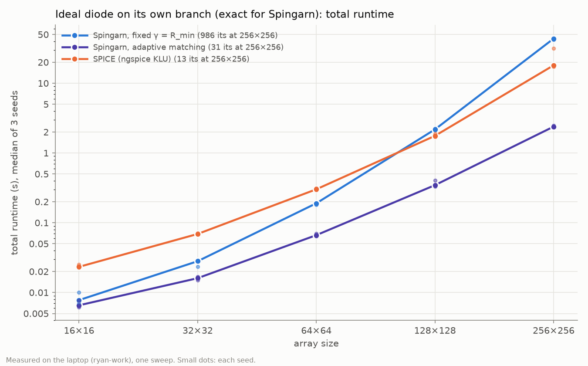
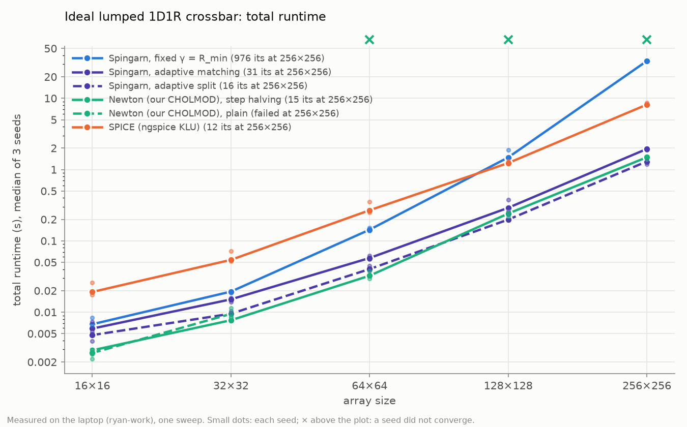
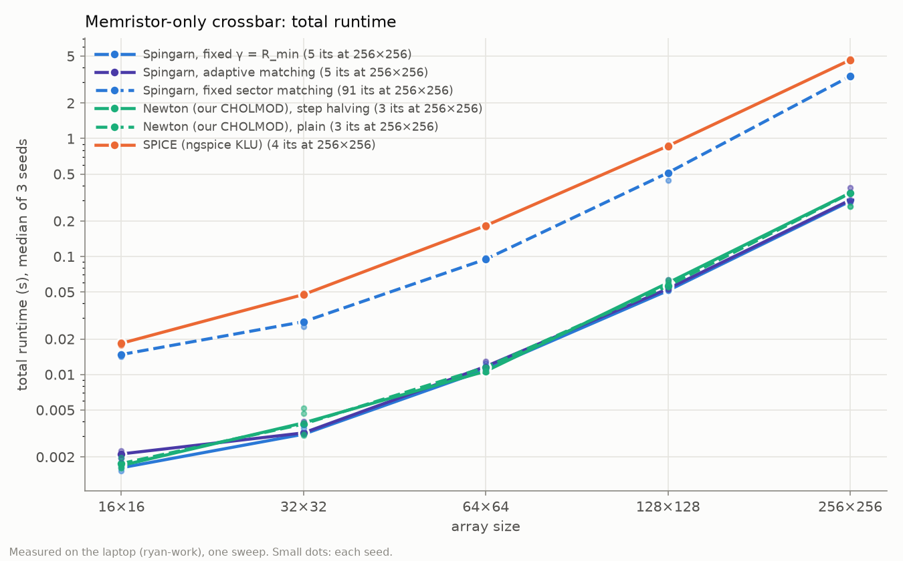
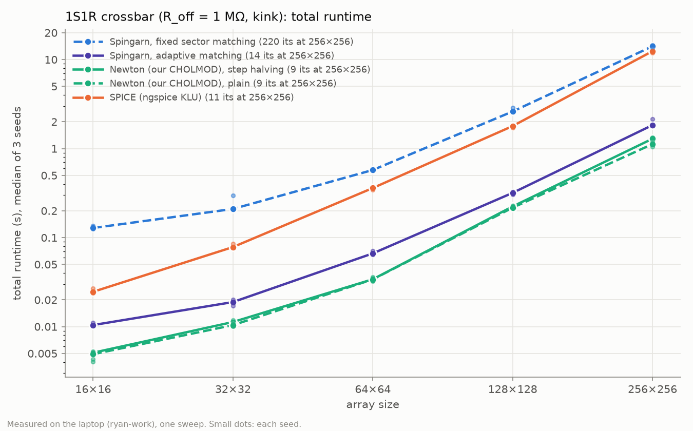
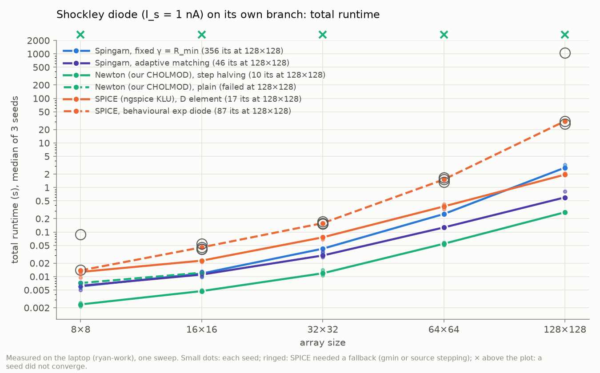

# Where Spingarn compares best

*2026-10-14. The cases where Spingarn does best against SPICE and against Newton, ranked from the biggest advantage to the smallest. Each case comes with one plot and its cell model, and §6 lists the cases where I expect Spingarn to pull further ahead on larger crossbars.*

*Every plot is one runner sweep on the laptop (ryan-work: Core Ultra 7 256V, 15.5 GB), plugged in, in "Best performance": sizes 16×16 to 256×256 (8×8 to 128×128 for case 5), 3 seeds, each run in its own process. Numbers are medians, with the range over seeds in brackets. Statements about 512×512 and above are either measured on the PC (report.md §7, [selector-scale](memory/selector-1s1r-findings.md)) and labelled so, or hypotheses.*

**How the ranking works.** Each case is ranked by Spingarn's advantage over its *strongest* competitor. That competitor is usually Newton on our own CHOLMOD factorization with step halving, which is now the bar to beat (report_diode_models.md §3.4); SPICE is far behind it in every case.

## Ranking

| rank | case | best Spingarn | vs strongest Newton | vs SPICE | memory vs SPICE | robustness |
|---|---|---|---|---|---|---|
| 1 | Ideal diode on its own branch | adaptive: 2.39 s | **Newton can't run it** (no finite Jacobian) | **7.6× faster** (5.1× at 128×128) | 3.8× less | the only solver of the exact model; SPICE needs R_on |
| 2 | Ideal lumped 1D1R | adaptive split: 1.30 s | **1.15× faster** | 6.3× faster | 3.4× less | plain Newton fails from 64×64 (2-cycle) |
| 3 | Memristor-only crossbar | fixed γ = R_min: 0.29 s | **tie** (1.17× by median, seed ranges overlap) | 15.8× faster (57× at 768×768 on the PC) | 3.5× less | SPICE fails at 1024×1024 (PC) |
| 4 | 1S1R (selector + memristor) | adaptive: 1.84 s | 1.6× slower | 6.7× faster | 5.0× less | SPICE fails at 768×768 (PC) |
| 5 | Shockley diode on its own branch | adaptive: 0.60 s (128×128) | 2.2× slower | 3.2× faster than `D`, 52× faster than `exp` | 2.3–7× less | plain Newton and SPICE `exp` fail; Spingarn never did |

*At 256×256, except case 5 (128×128). Memory is peak resident memory of the run's process.*

**In one line:** against SPICE, adaptive Spingarn wins every case by 3–16× with 2–5× less memory. Against Newton on the same factorization, it wins outright only where Newton can't run (rank 1) or needs a safeguard to converge (rank 2, narrowly). It ties on the nearly linear memristor crossbar and loses on 1S1R and Shockley cells.

**The common circuit.** p × p crossbar, word lines driven at their heads through 50 Ω sources, bit lines terminated at their feet by 1 kΩ loads, 5 Ω wires between neighbouring cross-points. The memristor in every cell is the tanh law

  g_m(v) = v/R_max + (1/R_min − 1/R_max)·tanh(v),

with incremental resistance in [R_min, R_max]. Cases 1, 2, 4 and 5 use per-cell R_min drawn from 1–10 kΩ and R_max from 50–200 kΩ, and inputs E ∈ [−1, 1.5] V. Case 3 uses report.md's nominal crossbar: R_min = 1 kΩ, R_max = 100 kΩ in every cell, E ∈ [0.1, 0.5] V.

## 1. Ideal diode on its own branch (exact model)

**Cell model.** An ideal diode from the word node to an internal node m, then the memristor from m to the bit node:

```
 w[r,c] ──▶|── m[r,c] ──[ memristor g_m ]── b[r,c]
        ideal diode
```

The diode is set-valued: v_d ≤ 0, i ≥ 0, v_d·i = 0. It conducts as a short or blocks as an open circuit, so it is *not* a function i(v), and its branch has no conductance to stamp. This is the same physical circuit as rank 2, written the way a netlist would be.
- **Spingarn** solves it exactly. The diode's resolvent is v = min(a, 0), i = max(a, 0)/γ.
- **Newton can't run it**: a conducting ideal diode has infinite conductance.
- **SPICE** needs a stand-in, `I = uramp(V)/R_on` with R_on = 1 mΩ. Its error is 1.2e-7 V at the word and bit nodes, and shrinking R_on below 1 mΩ makes it worse (report_diode_models.md §3.3).



| 256×256 | runtime | iterations | memory |
|---|---|---|---|
| Spingarn, adaptive matching (α 2/3) | 2.39 s [2.36–2.49] | 29–31 (8–9 re-matches) | 0.31 GB |
| Spingarn, fixed γ = R_min (α 0.8) | 43.6 s [42.2–43.9] | 951–995 | 0.27 GB |
| SPICE, uramp / 1 mΩ | 18.1 s [17.3–31.4] | 12–13 | 1.18 GB |
| Newton | cannot run | – | – |

- **Adaptive matching is the reason Spingarn wins.** It opens the blocked diodes in the network solve, which keeps the count flat at 22–31 iterations from 8×8 to 256×256. Fixed matching grows like the lumped 1D1R's and is slower than SPICE from 128×128 up.
- **The lead grows with size:** 3.6× at 16×16, 5.1× at 128×128, 7.6× at 256×256.

## 2. Ideal lumped 1D1R

**Cell model.** The same diode and memristor treated as one branch from w to b:

  i = g_m(max(v, 0)).

A reverse-biased cell is open; a forward-biased one carries its memristor's current. The law is single-valued and Lipschitz, with incremental resistance in [R_min, ∞). SPICE writes it with `uramp` inside the memristor source. Newton can run it.



| 256×256 | runtime | iterations | memory |
|---|---|---|---|
| Spingarn, adaptive split | 1.30 s [1.18–1.34] | 15–17 (6–7 re-matches) | 0.26 GB |
| Spingarn, adaptive matching (α 2/3) | 1.95 s [1.87–1.97] | 30–31 (9–10 re-matches) | 0.26 GB |
| Spingarn, fixed γ = R_min (α 0.8) | 33.3 s [33.2–33.3] | 941–986 | 0.23 GB |
| Newton, step halving | 1.49 s [1.42–1.52] | 15–16 (10 halvings) | 0.24 GB |
| Newton, plain | fails, 3 of 3 seeds | 2-cycle at the kink | – |
| SPICE | 8.14 s [8.09–8.70] | 12–13 | 0.88 GB |

- **Split is the only Spingarn variant that beats Newton,** and only narrowly: 1.21× at 128×128 and 1.15× at 256×256, with seed ranges that don't overlap. It refactorizes 6–7 times against Newton's 15–16.
- **Split has no convergence proof**, though it converged in every run here. Plain adaptive matching (provably convergent) is 1.3× slower than Newton.
- **Spingarn needs no safeguard.** Undamped, SPICE-style Newton on our factorization 2-cycles from 64×64; Spingarn converges as it is.

## 3. Memristor-only crossbar

**Cell model.** The memristor alone, one branch from w to b:

  i = g_m(v), with R_min = 1 kΩ and R_max = 100 kΩ in every cell.

Its sector is bounded, [R_min, R_max], so Spingarn contracts at α = 1 by a size-independent factor. At E ∈ [0.1, 0.5] V the cells see little voltage, so the crossbar is nearly linear.



| 256×256 | runtime | iterations | memory |
|---|---|---|---|
| Spingarn, fixed γ = R_min (α 1) | 0.294 s [0.294–0.294] | 5 | 0.23 GB |
| Spingarn, adaptive matching (α 1) | 0.301 s [0.289–0.381] | 5 (0 re-matches: it is fixed matching here) | 0.23 GB |
| Spingarn, fixed sector matching | 3.38 s [3.34–3.40] | 91 | 0.23 GB |
| Newton, plain and step halving | 0.344 s [0.266–0.346] | 2–3 | 0.24 GB |
| SPICE | 4.64 s [4.54–4.73] | 4 | 0.80 GB |

- **Against Newton it is a tie.** Spingarn does one factorization and 5 cheap iterations; Newton needs only 2–3 factorizations because the circuit is nearly linear. Seed 1 converged in 2 Newton steps and beat Spingarn.
- **Against SPICE it is the largest lead measured:** 15.8× here. On the PC (report.md §7) it is 57× at 768×768 (2.5 s against 145 s, with 5.8× less memory), and at 1024×1024 SPICE/KLU fails while Spingarn takes 4.8 s.
- **Adaptive matching never re-matches here,** because every memristor sits near its zero-bias resistance. That makes it bit-identical to fixed matching.

## 4. 1S1R (threshold selector + memristor)

**Cell model.** A symmetric threshold selector in series with the memristor:

```
 w[r,c] ──[ selector g_s ]── (m) ──[ memristor g_m ]── b[r,c]
```

- **The selector** is g_s(v) = v/R_off + (1/R_on − 1/R_off)·[max(v − V_th, 0) − max(−v − V_th, 0)], with R_on = 1 kΩ, R_off = 1 MΩ and V_th = 0.5 V. That is an exact kink at |v| = V_th (δ = 0).
- **The cell law:** i = g_s(v_s) = g_m(v_m) with v = v_s + v_m. Its incremental resistance lies in [R_on + R_min, R_off + R_max], which is finite.
- **How each solver writes it.** Spingarn and Newton treat the cell as one branch, solved by a nested monotone series solve. SPICE uses an internal node.



| 256×256 | runtime | iterations | memory |
|---|---|---|---|
| Spingarn, adaptive matching (α 1) | 1.84 s [1.81–2.15] | 14–16 (6–7 re-matches) | 0.26 GB |
| Spingarn, fixed sector matching (α 1) | 14.1 s [13.5–14.5] | 218–223 | 0.25 GB |
| Newton, plain | 1.12 s [1.05–1.16] | 8–9 | 0.25 GB |
| Newton, step halving | 1.29 s [1.24–1.33] | 9 (2 halvings) | 0.25 GB |
| SPICE | 12.4 s [11.9–12.5] | 10–11 | 1.31 GB |

- **Newton wins,** and its lead grew from 1.45× at 128×128 to 1.6× at 256×256. Each adaptive iteration repeats the selector's series solve: 92 ms per iteration against 67 ms per Newton factorization.
- **Spingarn beats SPICE** by 6.7× with adaptive matching. Fixed sector matching is slightly slower than SPICE at 256×256 (14.1 s against 12.4 s).
- **On the PC**, sector-matched Spingarn was 1.9× faster than SPICE at 512×512 (78.5 s against 146 s). At 768×768 SPICE failed while Spingarn took 174 s.

## 5. Shockley diode on its own branch

**Cell model.** As rank 1, but with an exponential diode:

  i_d = I_s·(e^{v_d/(n·V_T)} − 1), with I_s = 1 nA, n = 1, V_T = 25.85 mV.

```
 w[r,c] ──▶|── m[r,c] ──[ memristor g_m ]── b[r,c]
      Shockley diode
```

- **Spingarn's diode resolvent is closed-form** (Wright ω) and never overflows.
- **Newton has a finite but exponential Jacobian**; plain Newton has no junction limiting.
- **SPICE runs two variants:** the `D` element, which has pnjlim limiting but is SPICE3's law rather than exact Shockley, and a behavioural `exp()` source.



| 128×128 | runtime | iterations | memory |
|---|---|---|---|
| Spingarn, adaptive matching (α 2/3) | 0.60 s [0.57–0.82] | 46 (9–11 re-matches) | 0.15 GB |
| Spingarn, fixed γ = R_min (α 0.8) | 2.78 s [2.70–3.26] | 350–376 | 0.14 GB |
| Newton, step halving | 0.28 s [0.275–0.279] | 10 (2 halvings) | 0.15 GB |
| Newton, plain | fails, 3 of 3 seeds from 32×32 | Cholesky breaks down after the overshoot | – |
| SPICE, `D` element | 1.94 s [1.89–2.10] | 17 | 0.34 GB |
| SPICE, behavioural exp | 30.9 s [26.7–1047] | 86–90, gmin stepping in every run | 1.08 GB |

- **Spingarn's advantage here is robustness, not speed.**
  - Every Spingarn run converged, with no overflow and no fallback.
  - Plain Newton fails, and SPICE's exp variant needs fallbacks everywhere. It once declared convergence at node potentials of 4e71 V.
- **Step-halving Newton is 2.2× faster.** Spingarn still beats SPICE's `D` element by 3.2×.
- The Shockley *lumped* cell compares much the same (report_diode_models.md §3.1): Newton is 2.5–3× faster there.

## 6. Where Spingarn should pull further ahead on larger crossbars

These are hypotheses unless marked as measured.

1. **Against SPICE, in every case: high confidence, partly measured.**
   - SPICE/KLU fails outright at 1024×1024 on any crossbar, including a linear one, and at 768×768 on 1S1R, whose matrix carries an internal node per cell. Both were measured on the PC: report.md §7.4 and [ngspice-baseline-findings](memory/ngspice-baseline-findings.md).
   - Spingarn solved both, in 4.8 s and 174 s.
   - The ideal and Shockley diodes on their own branches have the same 3pq unknowns as 1S1R, so I expect SPICE to fail there at ~768×768 too (not measured).
   - Below that limit Spingarn's lead over SPICE grows with size: 3.6× → 7.6× from 16×16 to 256×256 on rank 1, and 9× at 16×16 → 57× at 768×768 on rank 3 (PC).
2. **Rank 1, the exact ideal diode: high confidence.** Newton can't run it at any size. Once SPICE hits its size limit (point 1), adaptive Spingarn is the only solver of the exact model. Its count was flat at 22–31 iterations up to 256×256, with re-matches growing only from 5 to 9.
3. **Ranks 2 and 3 against Newton: low to medium confidence, conditional on cheaper iterations.**
   - Spingarn needs fewer factorizations than Newton: one against 2–3 on the memristor crossbar, and 6–7 against 15–16 on the ideal lumped 1D1R, where Newton's count also grows with size (9 → 12 → 15 from 64×64 to 256×256).
   - When factorizations dominate the cost, that should become a lead of up to ~2×.
   - **But the measured trend points the other way so far.** From 128×128 to 256×256, Spingarn's time per iteration grew 6–7× (memory-bound vector work and triangular solves) against ~4× for Newton's refactorizations. On the PC at 1024×1024 only 136 of an iteration's 591 ms is the triangular solve (report.md §6.6).
   - So this hypothesis needs that per-iteration overhead cut first. Measuring Newton at 512–1024 on the PC would settle it.
4. **Rank 4 (1S1R) against Newton: low confidence.**
   - Adaptive refactorizes 6–7 times against Newton's 9, and SPICE's Newton count on the same circuits grew from 10–11 at 256×256 to 12–14 at 512×512 (PC).
   - If Newton's count keeps growing while adaptive's stays flat, and the selector's series solve becomes cheaper per iteration, adaptive could overtake at 1024×1024 or beyond. The gap still widened up to 256×256.
5. **Rank 5 (Shockley) against Newton: no reversal expected.** Step-halving Newton is flat at 7–11 iterations, and Spingarn's adaptive count is 46.

## Reproduction

```
python -X utf8 run_experiments.py --sizes 16 32 64 128 256 --runs 3 --algorithms spingarn spingarn_sector spingarn_adaptive newton newton_safeguarded spice --options '{"spingarn_adaptive": {"alpha": 1.0}}' --timeout 1800 --out results/best-memristor
python -X utf8 run_experiments.py --sizes 16 32 64 128 256 --runs 3 --algorithms spingarn_sector spingarn_adaptive newton newton_safeguarded spice --options '{"spingarn_adaptive": {"alpha": 1.0}}' --circuit '{"device": "1s1r", "E_range": [-1, 1.5], "R_min": [1000, 10000], "R_max": [50000, 200000], "R_on": 1000, "R_off": 1000000, "V_th": 0.5, "delta": 0}' --timeout 1800 --out results/best-1s1r-Roff1M
python -X utf8 run_experiments.py --sizes 16 32 64 128 256 --runs 3 --algorithms spingarn spingarn_adaptive spingarn_adaptive_split newton newton_safeguarded spice --options '{"spingarn": {"alpha": 0.8}}' --circuit '{"device": "1d1r", "E_range": [-1, 1.5], "R_min": [1000, 10000], "R_max": [50000, 200000]}' --timeout 1800 --out results/best-1d1r
python -X utf8 run_experiments.py --sizes 16 32 64 128 256 --runs 3 --algorithms spingarn spingarn_adaptive spice --options '{"spingarn": {"alpha": 0.8}}' --circuit '{"device": "1d1r", "internal_node": true, "E_range": [-1, 1.5], "R_min": [1000, 10000], "R_max": [50000, 200000]}' --timeout 1800 --out results/best-1d1r-internal
python -X utf8 best_comparisons_figures.py
```

The four sweeps ran back to back on the laptop on 2026-10-14, with nothing else running. Case 5 reuses `results/diode-models-scale-Is1e-9` from [report_diode_models.md](report_diode_models.md).
