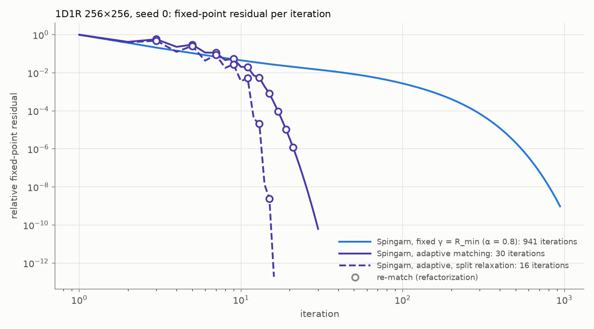
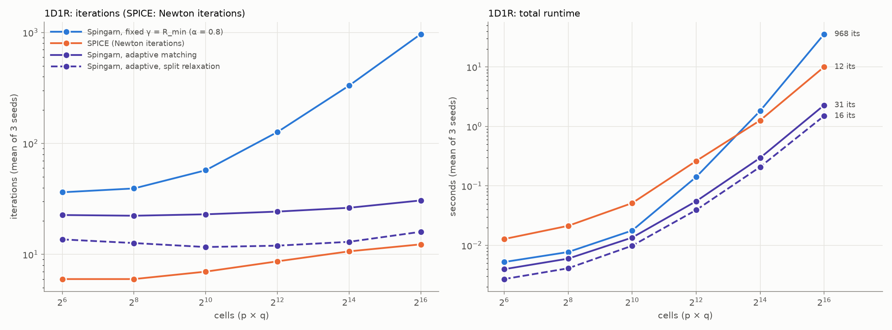
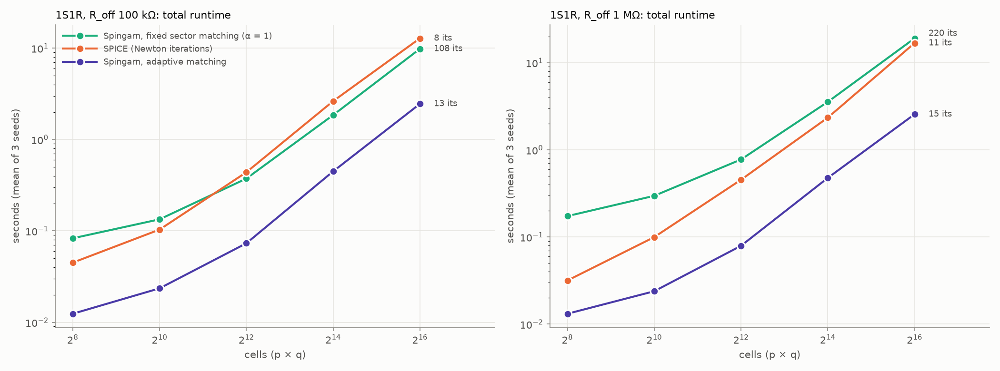

# Adaptive matching

*2026-10-14. Follows [report_nonsmooth.md](report_nonsmooth.md), whose next step 2 this takes up: re-matching cells to their current state during the iteration, with an occasional refactorization. The algorithm itself is described in report.md §1.*

*Every runtime here was measured on the laptop (ryan-work: Intel Core Ultra 7 256V, 15.5 GB RAM), plugged in, with Windows' "Best performance" mode. Runtimes are comparable within this report only, not with report_nonsmooth.md, which was measured on the PC. Iteration counts don't depend on the machine.*

## Summary

- **Adaptive matching re-matches cells to their current state during the iteration** (§1). This is the Scattering Iterative Method's "adaptation", with three additions:
  - reverse-biased diodes are matched as open circuits;
  - re-matching has hysteresis and a cap, so a run always ends as a provably convergent fixed-Γ iteration;
  - only the numeric factorization is redone.

  Existing solvers are bit-for-bit unchanged, and 70 tests pass (5 new).
- **On 1D1R it removes the growth with size (§2.2).**
  - 22–23 iterations at 8×8 and 30–31 at 256×256, against 35–37 and 941–986 with fixed matching.
  - It refactorizes 1–10 times.
  - The split variant takes 11–17 iterations.
- **The theory explains it (§2.3).**
  - At the final matching, the linearized spectrum is [−1, 0.003–0.019]. That predicts rates of 0.336–0.346 at α = 2/3, against 0.333–0.348 observed.
  - The cells it matches as open are exactly the reverse-biased cells at the solution: it finds report_nonsmooth.md's oracle matching without knowing the answer.
- **On 1S1R it cuts sector matching's ~108 or ~220 iterations to 9–16, flat in size (§3).**
- **Adaptive matching is the fastest solver measured, at every size from 8×8 to 256×256 on all three circuits.**
  - At 256×256 on 1D1R: 2.28 s, or 1.50 s split, against SPICE's 10.0 s and fixed matching's 35.7 s. The crossover where SPICE overtook Spingarn is gone.
  - On 1S1R: 2.46 s and 2.56 s, against SPICE's 12.8 s and 16.8 s and sector matching's 9.8 s and 19.1 s.
  - Overall that is 3–7× faster than SPICE, at matched or better accuracy and with ~4× less memory.
- **That speedup over SPICE can't yet be credited to the method (§4).** Adaptive Spingarn now refactorizes 5–10 times per solve, close to Newton's 8–13. Our CHOLMOD refactorization costs ~73 ms at 256×256, against ~300–450 ms for each of ngspice's KLU factorizations, and ngspice spends another ~3 s loading the netlist and reordering. Newton on our own factorization might well match or beat adaptive matching. That baseline is now the deciding experiment.

## 1. Method

### 1.1 The idea

- **The problem it fixes.** With one port resistance per cell, fixed for the whole run, the iteration's rate is set by how badly that resistance fits the cell's incremental resistance at the solution (report.md §1.3).
  - 1D1R: a reverse-biased cell is an open circuit, but zero-bias matching models it as R_min. On rows whose cells are all reverse-biased, q such resistors in parallel swamp the 50 Ω source, and the iteration's slowest mode approaches 1 as the array grows. Fixed matching took 36 iterations at 8×8 and ~970 at 256×256 (report_nonsmooth.md §2.3).
  - 1S1R: sector matching fits no cell well, because a selector is either far below or far above threshold. That gives ~110 or ~220 iterations, flat in size (report_nonsmooth.md §3).
- **The fix is the Scattering Iterative Method's "adaptation"** (Bernardini et al. 2018): give each cell the incremental resistance it currently has. Oracle matching, with the cells that end up reverse-biased given 10⁶ Ω, had already shown on 1D1R that the right matching restores a size-independent rate (report_nonsmooth.md §2.4). What was missing was a way to find that matching without knowing the answer.

### 1.2 The re-matching rule

`SpingarnAdaptiveSolver` ([algorithms/spingarns.py](algorithms/spingarns.py)) starts from zero-bias matching, γ = R_min per cell. Every 2 iterations, for each cell:

1. **Target.** The target is the cell's incremental resistance at the current branch point (v, i), clipped to its sector.
   - A reverse-biased 1D1R cell has infinite incremental resistance. Its target is `open_resistance`, 10⁸ Ω by default.
   - A 1S1R cell's incremental resistance comes from the selector and memristor voltages that its resolvent has just computed, so the check needs no extra series solve.
2. **Hysteresis.** A cell is re-matched only if its current port resistance reflects more than ½ against the target: |R − γ|/(R + γ) > 0.5. Near-linear cells therefore never trigger a refactorization, and memristor-only arrays are never re-matched at all.
3. **Refactorization.** If any cell changed, A Γ⁻¹ Aᵀ is refactorized.

After `max_rematches` re-matches (50 by default) Γ stays fixed for the rest of the run.

### 1.3 Carrying the iterate over

The resolvent v = J(a) is a bijection between incident waves and points on the cell's characteristic. The iterate is therefore the branch point (v, i). A re-match keeps that point and rewrites it in the new waves, a′ = v + γ′i, b′ = v − γ′i.

- **Open cells.** A reverse-biased cell has i = 0, so its waves don't change at all. Only the network solve sees the new port resistance.
- **The second solve.** The node potentials w of M·a, which the convergence test uses, are recomputed with one extra solve.

### 1.4 Refactorization

- **Only the values change.** Changing Γ changes the values of A Γ⁻¹ Aᵀ but not its sparsity pattern.
- **CHOLMOD.** `factorize` returns a solve that now also carries `refactor(K2)`. CHOLMOD keeps its symbolic analysis (the nested-dissection ordering and the supernodal structure) and redoes only the numeric factorization. SuperLU factorizes afresh.
- **Fixed-Γ solvers are untouched.** They never call it: `spingarn`, `spingarn_sector` and `spingarn_slu` gave bit-identical solutions and iteration counts before and after the change, on memristor, 1D1R and 1S1R circuits.

### 1.5 Termination

- **Why it terminates.** Between re-matches the iteration is the fixed-Γ iteration, and re-matches stop after a fixed number. From then on the existing theory applies:
  - contraction at any α ≤ 1 on cells with a bounded sector (memristors, 1S1R);
  - convergence for α < 1 on 1D1R cells (Krasnosel'skii–Mann).
- **What it doesn't promise.** Nothing guarantees the matching settles before the cap. Measured below, it settles after 1–10 re-matches.

### 1.6 Relaxation: why α = 2/3, and the split variant

- **The −1 mode.** An open cell matched at 10⁸ Ω sits on a network that, seen from its port, is nearly a short. Its wave therefore bounces back almost unchanged, with alternating sign, and the iteration has an eigenvalue at −1 there (λ_min = −1.00000 below).
- **Why 2/3.** Relaxation maps an eigenvalue λ to 1 − α + αλ, so −1 goes to 1 − 2α. With every other eigenvalue near 0 once the cells are matched, α = 2/3 balances the two ends, at a rate of 1/3. That is `spingarn_adaptive`'s default, and it is what the oracle spectrum predicted (report_nonsmooth.md §2.4).
- **α on bounded-sector cells.** On memristor and 1S1R arrays no cell is ever open, and α = 1 is faster. The 1S1R runs below use α = 1.
- **The split variant.** `spingarn_adaptive_split` relaxes only the open cells, by ½, and runs every other branch at α = 1.
  - The argument: as open_resistance → ∞, open cells drop out of the network solve. The other branches then run the fixed-Γ iteration of the circuit without them, and ½ sets each open cell's wave to exactly the voltage the network puts across it.
  - **At a finite open_resistance that's a heuristic. It has no convergence proof.** It also costs one more solve per iteration, because M·a no longer follows from M·a and M·b.
  - One setting suits every cell type. On 1D1R it takes about half the iterations.

### 1.7 Code changes and verification

- **New solvers.** `spingarn_adaptive` and `spingarn_adaptive_split` are registered for the experiment runner. In plots they take the violet slot, shared with `condat_vu`. The dataviz validator passes violet beside spingarn and spice (worst CVD ΔE 13.0) and beside spingarn_sector and spice (9.2).
- **70 tests pass across all seven test files,** SPICE's included. The five new tests in [testing/test_spingarn.py](testing/test_spingarn.py) cover:
  - `refactor` against a fresh factorization, on both libraries and both orderings, plus rejection of a changed sparsity pattern;
  - agreement with the independent Newton solve on 1D1R and 1S1R crossbars (kink and rounded knee), for both variants, with at least one re-match;
  - bit-identity with `spingarn` when nothing is re-matched;
  - the re-match cap;
  - flat iteration counts against fixed matching;
  - option validation and a runner round-trip.

## 2. 1D1R

### 2.1 Setup

- **Circuit.** The 1D1R circuit of report_nonsmooth.md §2:
  - E ∈ [−1, 1.5] V;
  - R_min 1–10 kΩ and R_max 50–200 kΩ per cell;
  - wires 5 Ω, sources 50 Ω, loads 1 kΩ;
  - seeds 0–2, sizes 8×8 to 256×256. 256×256 is the laptop's size cap.
- **Solvers.**
  - `spingarn` (fixed γ = R_min, α = 0.8, as in report_nonsmooth.md §2.6);
  - `spingarn_adaptive` (α = 2/3) and `spingarn_adaptive_split`, both at tol 1e-9;
  - SPICE at RELTOL 1e-3 with KLU.
- **Runs.** The experiment runner, each run in its own process, solvers interleaved per seed. Results are in `results/adaptive-1d1r`.

### 2.2 Iterations

| size | fixed γ = R_min, α = 0.8 | adaptive, α = 2/3 (re-matches) | split (re-matches) | SPICE Newton |
|---|---|---|---|---|
| 8×8 | 35–37 | 22–23 (1–2) | 12–15 (1–2) | 6 |
| 16×16 | 37–42 | 22–23 (2–4) | 11–14 (2) | 6 |
| 32×32 | 53–60 | 23 (5) | 11–12 (3) | 7 |
| 64×64 | 125–128 | 24–25 (6) | 11–13 (4–5) | 8–9 |
| 128×128 | 325–342 | 25–27 (7) | 13 (5) | 10–11 |
| 256×256 | 941–986 | 30–31 (9–10) | 15–17 (6–7) | 12–13 |

*Ranges over seeds 0–2.*

- **The growth with size is gone.** Over a 1000-fold increase in cells, fixed matching grows 27-fold. Adaptive matching grows from 22 to 31 iterations, and split from ~13 to ~16. SPICE's Newton count doubles over the same range.
- **Refactorizations grow slowly:** 1–2 at 8×8, 6–10 at 256×256. The default cap of 50 was never reached.
- **The matching settles early.** At 256×256 the last re-match comes at iteration ~20 (Figure 2). Before it, every re-match visibly speeds the iteration up; after it, the residual falls at the predicted rate.



*Figure 2. 1D1R 256×256, seed 0: fixed-point residual against iteration (log–log), with each re-match marked. Fixed matching needs 941 iterations, adaptive 30, split 16.*

### 2.3 The spectrum at the final matching

As in report_nonsmooth.md §2.3, the iteration at the solution is linear. Under the matching the adaptive solver ends with, D ≥ 0: conducting cells are matched (D ≈ 0) and open cells reflect fully (D = +1). So Lanczos on the symmetric D^½ S̃ D^½ gives the extreme eigenvalues λ of S·D, and the rate at α = 2/3 is max |1/3 + 2/3·λ|. The split variant's per-branch relaxation isn't symmetrizable, so its spectral radius comes from Arnoldi on J itself. [adaptive_spectrum.py](adaptive_spectrum.py), results in `results/adaptive-spectrum`.

| size (seed) | fixed: iterations | fixed: λ range | adaptive: iterations (re-matches) | adaptive: λ range | adaptive: rate predicted / observed | split: rate predicted / observed | cells matched open / reverse-biased at the solution |
|---|---|---|---|---|---|---|---|
| 16×16 (0) | 39 | [−0.9989, 0.359] | 23 (4) | [−1.00000, 0.0161] | 0.344 / 0.345 | 0.160 / 0.119 | 141 / 141 |
| 16×16 (1) | 42 | [−0.9990, 0.520] | 22 (2) | [−1.00000, 0.0187] | 0.346 / 0.348 | 0.195 / 0.139 | 176 / 176 |
| 32×32 (0) | 53 | [−0.9992, 0.612] | 23 (5) | [−1.00000, 0.0151] | 0.343 / 0.340 | 0.128 / 0.058 | 677 / 677 |
| 32×32 (1) | 60 | [−0.9992, 0.651] | 23 (5) | [−1.00000, 0.0170] | 0.345 / 0.340 | 0.096 / 0.032 | 718 / 718 |
| 64×64 (0) | 128 | [−0.9992, 0.833] | 25 (6) | [−1.00000, 0.0071] | 0.338 / 0.334 | 0.054 / 0.002 | 2957 / 2957 |
| 64×64 (1) | 125 | [−0.9992, 0.827] | 24 (6) | [−1.00000, 0.0080] | 0.339 / 0.334 | 0.041 / 0.001 | 2783 / 2783 |
| 128×128 (0) | 325 | [−0.9992, 0.935] | 27 (7) | [−1.00000, 0.0044] | 0.336 / 0.333 | 0.027 / <0.001 | 11227 / 11227 |
| 128×128 (1) | 329 | [−0.9992, 0.935] | 25 (7) | [−1.00000, 0.0033] | 0.336 / 0.333 | 0.058 / <0.001 | 11355 / 11355 |

*Fixed: γ = R_min, α = 0.8, run in-process for this table. Predicted rate: ρ(J) at the solution. Observed rate: the geometric-mean per-iteration ratio of the fixed-point residual from the last re-match to convergence.*

- **The theory predicts adaptive's rate to within 0.005 at every size.** At the final matching, λ_max is 0.003–0.019, and it shrinks as the array grows. Under fixed matching it climbs from 0.36 to 0.94. λ_min = −1.00000 is the open cells' mode (§1.6), which α = 2/3 maps to −1/3.
- **The re-matching finds the oracle's matching.** The cells matched as open at the end are exactly the reverse-biased cells at the solution, in every case. Their spectrum reproduces report_nonsmooth.md §2.4's oracle (λ_max 0.015, 0.007 and 0.0045 at 32, 64 and 128).
- **Split's prediction isn't tested by these runs.** Only 2–5 iterations follow its last re-match, too few to reach the asymptotic rate, so the observed ratio falls well below the predicted spectral radius. Its predicted rates, 0.03–0.20, are themselves 2–10× better than adaptive's 1/3.

### 2.4 Runtime against SPICE

| size | fixed γ = R_min | SPICE | adaptive | split | adaptive vs SPICE | split vs SPICE |
|---|---|---|---|---|---|---|
| 8×8 | 0.0052 s | 0.0128 s | 0.0040 s | 0.0027 s | 3.2× | 4.7× |
| 16×16 | 0.0077 s | 0.0213 s | 0.0060 s | 0.0041 s | 3.6× | 5.2× |
| 32×32 | 0.0177 s | 0.0513 s | 0.0135 s | 0.0099 s | 3.8× | 5.2× |
| 64×64 | 0.141 s | 0.262 s | 0.055 s | 0.039 s | 4.7× | 6.7× |
| 128×128 | 1.82 s | 1.26 s | 0.296 s | 0.208 s | 4.3× | 6.1× |
| 256×256 | 35.7 s | 10.0 s | 2.28 s | 1.50 s | 4.4× | 6.7× |

*Total runtime, mean of 3 seeds; "×" is how many times faster than SPICE.*



*Figure 1. 1D1R: iterations (left; SPICE's are Newton iterations) and total runtime (right) against size, mean of 3 seeds. Labels give the iterations at 256×256.*

- **The crossover with SPICE is gone.** With fixed matching, SPICE won from 128×128 up: 4.2× at 256×256 on the PC, 3.6× here. Adaptive matching is faster than SPICE at every size, and 16× faster than fixed matching at 256×256.
- **Where adaptive's time goes at 256×256** (mean of 3 seeds):
  - setup 0.14 s, including the first factorization (0.11 s);
  - 9–10 refactorizations, 0.81 s in total, ~73 ms each. Numeric refactorization costs about as much as the first full factorization, because the numeric phase dominates at this size;
  - 30–31 iterations, 1.32 s, at 43 ms each against fixed matching's 37 ms.
- **Split** spends 0.55 s on 6–7 refactorizations and 0.80 s on 16 iterations, at 50 ms each because of its extra solve per iteration.
- **Timing noise.** Seed 2 ran ~1.5× slower than seeds 0–1 throughout the process: 55 against 36 ms per iteration, and 114 against 73 ms per refactorization, at identical iteration counts. That is the same unexplained 256×256 spread as report_nonsmooth.md §2.6. Means include it.
- **Memory at 256×256:** 0.25 GB for both adaptive variants and 0.23 GB for fixed matching, against SPICE's 0.88 GB.

### 2.5 Accuracy

- **Solutions agree with SPICE's** to max |Δv| ≤ 2.5e-9 V (adaptive) and ≤ 1.0e-8 V (split) at every size. Fixed matching agrees to ≤ 9.6e-8 V.
- **Absolute KCL residuals.** Every solver passes the same KCL test (`kcl_check`). The worst absolute residuals at 64×64 to 256×256 are:
  - SPICE ~1.5e-15 A;
  - fixed matching ~1e-12 A, which is the test's absolute tolerance of 1 pA;
  - adaptive 3.5e-13 to 9.4e-13 A;
  - split 4e-15 to 7.5e-14 A.
- **Split is nearly as accurate as SPICE.** Its final rate is so fast that, like Newton, it overshoots the tolerance.
- **The relative residual still isn't meaningful here.** 30–44% of nodes sit on dead lines, as in report_nonsmooth.md §2.6.

## 3. 1S1R

### 3.1 Setup

- **Circuit.** The 1S1R circuits of report_nonsmooth.md §3: R_on 1 kΩ, V_th 0.5 V, δ = 0 (the kink), R_off 100 kΩ or 1 MΩ, and the same memristors and inputs as §2.
- **Solvers.**
  - `spingarn_sector` (α = 1);
  - SPICE;
  - `spingarn_adaptive` at α = 1. No cell is ever open here, so the split variant is the same algorithm and wasn't run.
- **Runs.** Seeds 0–2, sizes 16×16 to 256×256. Results are in `results/adaptive-1s1r-Roff100000` and `results/adaptive-1s1r-Roff1000000`.

### 3.2 Results

| size | R_off 100 kΩ: sector | SPICE | adaptive | R_off 1 MΩ: sector | SPICE | adaptive |
|---|---|---|---|---|---|---|
| 16×16 | 0.083 s (95–105) | 0.045 s (5–6) | 0.012 s (9–12) | 0.174 s (209–219) | 0.032 s (5–6) | 0.013 s (9–12) |
| 32×32 | 0.134 s (103–104) | 0.103 s (6) | 0.024 s (10–12) | 0.297 s (210–217) | 0.100 s (6–7) | 0.024 s (10–12) |
| 64×64 | 0.374 s (103–105) | 0.438 s (7–8) | 0.073 s (11–12) | 0.776 s (211–217) | 0.454 s (7–8) | 0.079 s (12) |
| 128×128 | 1.85 s (107–108) | 2.63 s (8) | 0.448 s (13) | 3.55 s (216–219) | 2.34 s (8–9) | 0.477 s (14) |
| 256×256 | 9.84 s (108–109) | 12.8 s (8) | 2.46 s (13) | 19.1 s (218–223) | 16.8 s (10–11) | 2.56 s (14–16) |

*Total runtime (iterations; SPICE: Newton iterations), mean of 3 seeds. Adaptive re-matched 2–5 times (100 kΩ) or 2–7 times (1 MΩ).*



*Figure 3. 1S1R (kink): total runtime against size for sector matching, SPICE and adaptive matching, at both selector strengths. Labels give the iterations at 256×256.*

- **Iterations drop 8–20× and stay flat.** Sector matching sits at its a priori bound: ~108 or ~220 iterations, whatever the size. Adaptive matching needs 9–16 and barely depends on R_off, because each cell is matched to the state it is actually in.
- **Adaptive is the fastest solver at every size.** It is 2.4–6.6× faster than SPICE: at 256×256, 5.2× (100 kΩ) and 6.6× (1 MΩ). Sector matching only began beating SPICE around 256×256 (report_nonsmooth.md §3.3; here it is 1.3× faster at 100 kΩ and 1.1× slower at 1 MΩ).
- **An adaptive iteration costs more than a sector one.** At 256×256, 109–149 ms against 83–97 ms. The selector's series solve takes 2–3× more Newton steps per iteration (3.6–14 against 1.6–6.6). With only ~13 iterations, each iteration moves the cell states further, and a re-match changes a cell's port resistance up to ~600-fold, so the warm starts help less.
- **Accuracy is matched.** Every node carries current here, so the relative residuals compare directly:
  - worst recorded relative KCL residuals from 64×64 up: adaptive 6.5e-11 to 4.8e-8, sector 1.7e-9 to 4.5e-7, SPICE 2.1e-11 to 2.9e-8;
  - solutions agree with SPICE's to ≤ 1.2e-9 V (adaptive) and ≤ 1.3e-9 V (sector).
- **Memory at 256×256:** 0.26 GB, against SPICE's 1.31 GB.

## 4. What the comparison with SPICE does and doesn't show

**Adaptive Spingarn now refactorizes about as often as Newton does.** At 256×256 it refactorizes 5–10 times, against SPICE's 8–13 factorizations, one per Newton iteration. That changes what the runtime comparison measures.

- **SPICE's time at 256×256 on 1D1R** (mean ~10 s) breaks down as:
  - loading the netlist, 1.9–2.5 s;
  - KLU's reordering, 0.9–1.4 s;
  - 12–13 KLU factorizations, 3.7–5.4 s in total, or 300–450 ms each;
  - the rest is matrix loading, solves and result extraction.
- **Our factorization is 4–6× cheaper per call.** One re-match takes ~73 ms on a matrix of the same size: a numeric CHOLMOD refactorization in the nested-dissection ordering, plus rebuilding the matrix and one extra solve. (SPICE's 1S1R matrix is also 1.5× larger, because of an internal node per cell.)
- **A rough estimate, not a measurement:** Newton with this solver's own factorization would cost about 12 × (73 ms + a solve and the device evaluation) plus setup, roughly 1–1.5 s at 256×256 on 1D1R. That is comparable to adaptive's 2.3 s and split's 1.5 s, and on 1S1R (8–11 Newton iterations) quite possibly faster than adaptive's 2.5 s.
- **So the measured 3–7× over SPICE can't yet be credited to the iteration rather than the linear solver and ngspice's overheads.** What adaptive matching does establish is a fix within the Spingarn family:
  - on 1D1R, size independence is back and the method is 16× faster at 256×256;
  - on 1S1R, iterations drop ~10× and runtime 4–7×;
  - both at matched accuracy, with ~4× less memory than SPICE.
- **The deciding experiment is now report_nonsmooth.md's next step 1,** a Newton (or chord) baseline on the same CHOLMOD and nested-dissection factorization.

## 5. Relation to prior work

- **The re-matching itself is the Scattering Iterative Method's adaptation** (Bernardini et al. 2018), and its wave-digital follow-ups recompute the scattering matrix dynamically.
- **What this report adds, as far as the earlier literature check went:**
  - re-matching with hysteresis and a cap, which inherits the fixed-Γ convergence theory;
  - open-circuit matching for ideal diodes, the −1 mode it creates, and α = 2/3, which balances it (rate predicted and measured at ~1/3);
  - the split relaxation;
  - numeric-only refactorization in a nested-dissection ordering;
  - 65,536 nonlinear cells (SIM: 6,400).
- **The follow-up papers weren't read in full,** so even these claims are provisional.

## 6. Limitations

- **Measurements.**
  - One machine (the laptop) and three seeds per configuration.
  - Sizes up to 256×256 only, your cap for the laptop. At 768×768 and above, where SPICE fails (report_nonsmooth.md §3.3), adaptive matching hasn't been run.
  - At 256×256 runs with identical iteration counts varied up to 1.5× in time (§2.4).
- **The defaults were tuned on these same circuit families:**
  - re-matching every 2 iterations, the ½ threshold, open_resistance 10⁸ Ω, α = 2/3;
  - they come from prototype runs on seed 0 at 64–256, without a check on other circuits. γ_open between 10⁶ and 10¹⁰ Ω made no difference; α = 0.6 or 0.75 cost 10–30% more iterations; re-matching every iteration or every 4 traded refactorizations against iterations at about equal cost.
- **The split variant has no convergence proof** at a finite open_resistance. It converged in every run here.
- **The KCL test's absolute tolerance still governs low-current nodes.** On 1D1R, adaptive (not split) stops near the 1 pA abstol, while SPICE reaches ~1e-15 A.
- **No Newton baseline on the same factorization** (§4).
- **The 1D1R circuit still doesn't exercise the tanh** at scale (report_nonsmooth.md §2.5); what it exercises is the diode.

## 7. Next steps

1. **Newton and chord baselines on CHOLMOD with nested dissection** (§4). This decides whether Spingarn's iteration, rather than its linear solver, beats Newton on these arrays.
2. **512×512 to 1024×1024 on the PC,** where ngspice's KLU fails. Adaptive matching's cost per size step there, against the baseline of step 1.
3. **Cheaper late re-matches.** After the first few re-matches only 1–20 cells change, which calls for a low-rank update of the Cholesky factor (CHOLMOD's update/downdate) instead of a full numeric refactorization. cvxopt doesn't expose it.
4. **sinh-like memristors** (deferred): the remaining candidate where Newton itself may struggle.

## 8. Reproduction

```
python run_experiments.py --sizes 8 16 32 64 128 256 --runs 3 --algorithms spingarn spice spingarn_adaptive spingarn_adaptive_split --options '{"spingarn": {"alpha": 0.8}}' --circuit '{"device": "1d1r", "E_range": [-1, 1.5], "R_min": [1000, 10000], "R_max": [50000, 200000]}' --timeout 1800 --out results/adaptive-1d1r
python run_experiments.py --sizes 16 32 64 128 256 --runs 3 --algorithms spingarn_sector spice spingarn_adaptive --options '{"spingarn_adaptive": {"alpha": 1.0}}' --circuit '{"device": "1s1r", "E_range": [-1, 1.5], "R_min": [1000, 10000], "R_max": [50000, 200000], "R_on": 1000, "R_off": 100000, "V_th": 0.5, "delta": 0}' --timeout 1800 --out results/adaptive-1s1r-Roff100000
python run_experiments.py ... (the same with "R_off": 1000000) --out results/adaptive-1s1r-Roff1000000
python adaptive_spectrum.py --sizes 16 32 64 128 --seeds 2 --out results/adaptive-spectrum
python -X utf8 adaptive_matching_figures.py
```

The three sweeps ran back to back on the laptop, plugged in and in "Best performance" mode, with nothing else running.

**Files changed**

| file | change |
|---|---|
| [algorithms/spingarns.py](algorithms/spingarns.py) | `factorize` returns a solve with `refactor`; `cell_conductance`; a re-matching hook in the loop (unused by fixed-Γ solvers); `SpingarnAdaptiveSolver`, `SpingarnAdaptiveSplitSolver`, `_Rematching` |
| [algorithms/\_\_init\_\_.py](algorithms/__init__.py) | registers `spingarn_adaptive` and `spingarn_adaptive_split` |
| [plotting.py](plotting.py) | pins both to the violet slot, split dashed |
| [testing/test_spingarn.py](testing/test_spingarn.py) | 5 new tests, plus new cases in the option-validation test |
| [adaptive_spectrum.py](adaptive_spectrum.py) (new) | spectra at the final matching against observed rates |
| [adaptive_matching_figures.py](adaptive_matching_figures.py) (new) | this report's figures and tables |
