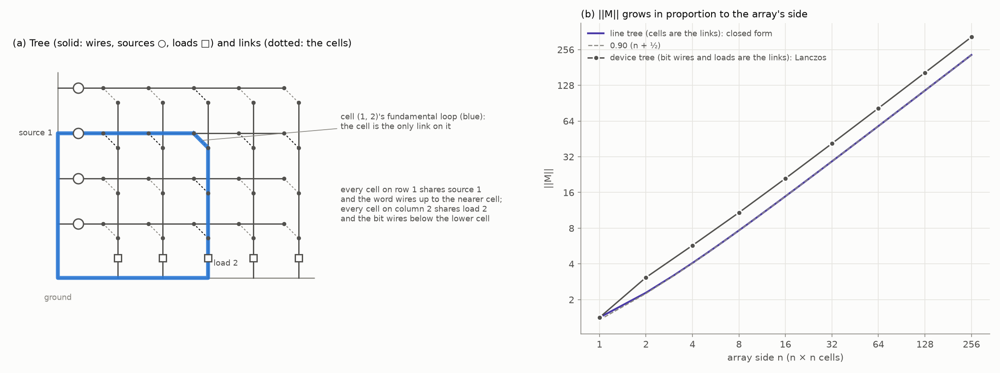
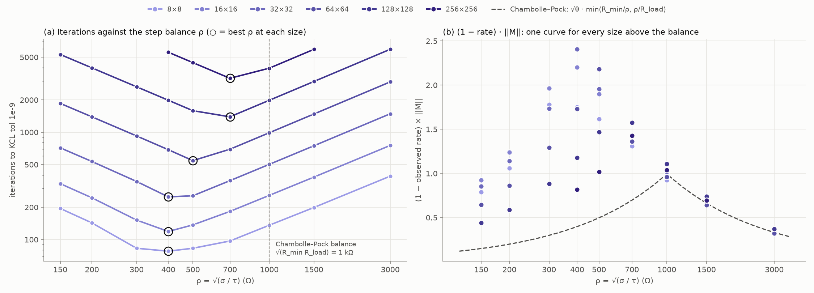
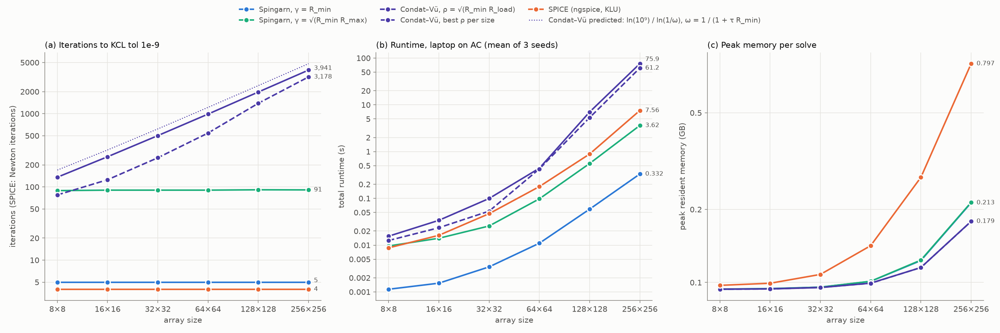
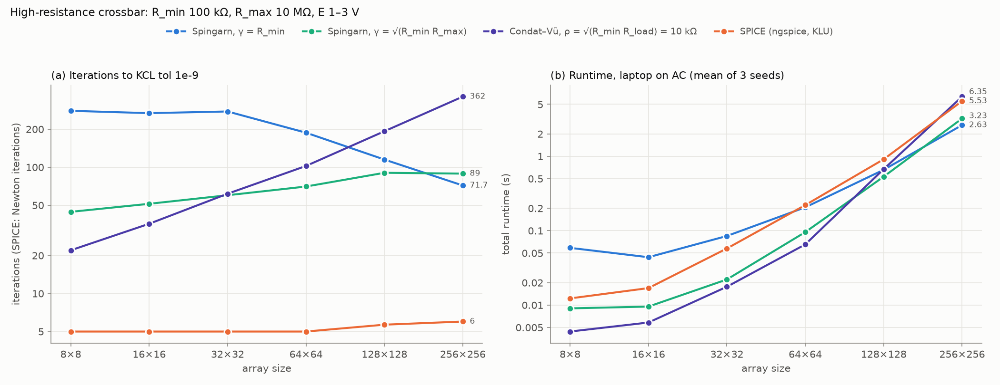
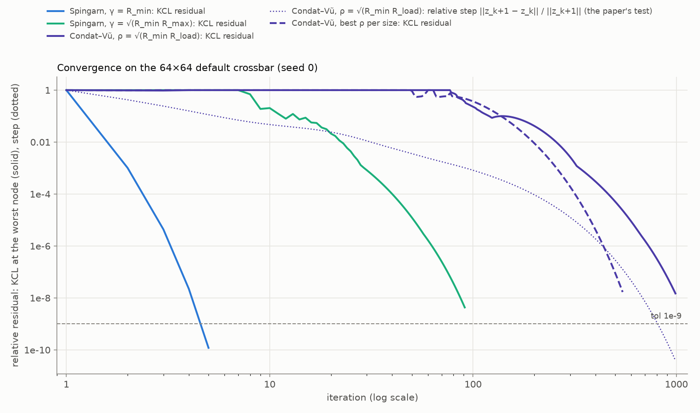

# Condat–Vũ splitting vs Spingarn's method on the tanh crossbar

*2026-10-13. Implements Algorithm 1 of Chaffey, Banert, Giselsson and Pates, "Circuit analysis using monotone+skew splitting" (European Journal of Control 74 (2023) 100854), for the DC operating point of the memristor crossbar, and compares it with Spingarn's method (report.md) and SPICE. This report covers the smooth case only: every cell is the tanh memristor (`device="memristor"`). The non-smooth cells come next.*

*Every measurement was made on the laptop (ryan-work: Intel Core Ultra 7 256V, 15.5 GB RAM), with sizes up to 256×256 as you asked. The timed sweeps ran on AC power in Windows' "Best performance" mode (§4.1 explains why that matters). Runtimes are comparable within this report only. ngspice-47 was installed on the laptop for this comparison.*

## Summary

- **The paper's algorithm is implemented** as the solver `condat_vu` ([algorithms/condat_vu.py](algorithms/condat_vu.py)). It agrees with the Newton reference to ~1e-10 and passes 11 new tests; all 45 existing tests still pass.
- **The two methods differ in a single step.** Both solve every branch locally, with the same kind of per-branch solve (a resolvent). Then:
  - Spingarn couples the branches by solving the network exactly: one Cholesky factorization, reused every iteration.
  - Condat–Vũ couples them by multiplying with a tree–cotree matrix M, which on the crossbar is a cumulative sum along each line. It never factorizes anything, but it must keep its step sizes below τσ‖M‖² < 1.
- **‖M‖ grows with the array, so Condat–Vũ's iteration count does too.** On the crossbar ‖M‖ has a closed form, about 0.90(n + ½) for an n×n array. Every cell's fundamental loop runs through its row's source and its column's load, so each source and load is shared by a whole line of loops.
- **Measured: Condat–Vũ needs 136 iterations at 8×8 and ~3,940 at 256×256, about 17‖M‖ throughout.** Spingarn needs 5 (or ~91 sector-matched) and SPICE 4 Newton iterations, both flat in size.
- **The theory predicts Condat–Vũ's rate to 3–4 digits.** For step balances ρ at or above Chambolle and Pock's choice, the rate per iteration is 1/(1 + τR_min): the damping a single cell gets from its own resolvent. Some current patterns are barely coupled by M (its singular values spread by a factor ≈ 1.27n), and those patterns get nothing else. Chambolle and Pock's Theorem 3 guarantees only half that rate in the exponent.
- **Tuning the step balance helps less as arrays grow:** about 2× fewer iterations than the theory default at 16×16 and 32×32, but 1.24× at 256×256. The best balance drifts toward the theory's as arrays grow.
- **Runtime on the default crossbar:** Condat–Vũ is the slowest solver at every size from 8×8 to 256×256.
  - At 256×256 (means of 3 seeds) it takes 76 s, or 61 s at its best balance. SPICE takes 7.6 s, Spingarn 0.33 s, and sector-matched Spingarn 3.6 s.
  - Its iterations cost half of Spingarn's (19 vs 38 ms at 256×256), it never factorizes, and it uses the least memory (0.18 GB, against 0.21 for Spingarn and 0.80 for SPICE).
  - It loses on its iteration count: 43× sector-matched Spingarn's, ~800× zero-bias Spingarn's. On an n×n array its total work grows like n³ = N^1.5. That is the same exponent as nested-dissection Cholesky's flops, but with a far larger constant.
- **The nonlinearity doesn't move Condat–Vũ's count.** Its rate sees only the cells' smallest incremental resistance. Spingarn's zero-bias matching pays the most (5 → 12 iterations from E 0.1–0.5 V to 1–3 V).
  - The default crossbar barely exercises the tanh at scale: making the cells linear changes the 64×64 outputs by under 0.05%.
  - On a high-resistance crossbar where the tanh matters (outputs change 37–89% if linearized), Condat–Vũ's constant is 10× better, as μ_R μ_G = 100 predicts. It is the fastest of all four solvers up to 64×64.
  - Its count still doubles with the side there. Spingarn overtakes it between 64×64 and 128×128, and SPICE between 128×128 and 256×256 (§4.7).
- **Two practical points for the paper's method.**
  - The partition matters. Putting the cells in the tree is 2–6× slower at 2×2–8×8, and the gap widens with size. The theory says to put low-resistance branches in the tree.
  - The paper's stopping test, the change between iterates, misjudges the error by a factor that grows with ‖M‖. At the same tolerance it stops 15× (8×8) to 1200× (256×256) short of the KCL target (§4.9).

## 1. Two splittings of the same circuit

A DC solution is a set of branch voltages v and currents i with v = Aᵀu (KVL), Ai = 0 (KCL) and i_e = g_e(v_e) on every branch. Both methods keep the branch laws local. They differ in how they write and enforce KCL and KVL.

### 1.1 Spingarn's method (report.md §1)

- **KCL and KVL form a pair of subspaces:** voltages in range(Aᵀ), currents in ker(A).
- **The iteration works in waves**, a = v + Γi and b = v − Γi, with a diagonal matrix Γ of port resistances, one per branch.
  1. Each branch scatters its incident wave through its own law (its resolvent).
  2. The network reflects the waves through S_Γ = 2P_Γ − I, where P_Γ = Aᵀ(AΓ⁻¹Aᵀ)⁻¹AΓ⁻¹ projects onto KVL.
- **The network step is an exact linear solve** with the nodal matrix AΓ⁻¹Aᵀ. Γ is fixed, so that matrix is factorized once (CHOLMOD, in a geometric nested-dissection ordering), and every iteration costs two triangular solves.
- **It is Douglas–Rachford splitting**: Spingarn's method of partial inverses, of the branch relations and the KVL subspace. The repo runs its unrelaxed form, α = 1 (Peaceman–Rachford). In waves it is the Scattering Iterative Method of Bernardini et al. (2018).

### 1.2 Condat–Vũ, as in the paper

- **KCL and KVL as the graph of a skew map** (the paper's Theorem 1, "element extraction"). Pick a spanning tree. Its branch voltages are independent and fix every node potential; the remaining branches, the links, have independent currents that fix every branch current. With $A_T$ and $A_L$ the tree and link columns of A:

  $i_T = M i_L$ (KCL) and $v_L = -M^T v_T$ (KVL), with $M = -A_T^{-1} A_L$.

- **The circuit becomes a monotone + skew inclusion** (the paper's eq. (5)). Tree branches are written as admittances G (voltage → current) and links as impedances R (current → voltage):

  $0 = R(i_L) + M^T v_T, \qquad 0 = G(v_T) - M i_L.$

- **Algorithm 1** alternates a link step and a tree step, with step sizes τ and σ:

  $i_L \leftarrow (I + \tau R)^{-1}(i_L - \tau M^T v_T), \qquad v_T \leftarrow (I + \sigma G)^{-1}(v_T + \sigma M(2 i_L^{new} - i_L^{old})).$

  It converges when $\tau\sigma\|M\|^2 < 1$ (Condat 2013, Vũ 2013). M is only ever multiplied, never inverted. That is the property the paper highlights: "low-cost iterations that make it suitable for solving large-scale problems".
- **On the crossbar** the natural tree is every wire, source and load. Each word line then hangs from its source and each bit line from its load, and the links are exactly the pq cells. So $i_L$ are the cell currents and $v_T$ the wire, source and load voltages.
  - $M i_L$ is a cumulative sum along each line: a word wire carries the current of every cell beyond it on its row, a source carries its row's total, a load its column's total.
  - $-M^T v_T$ is the cell voltages, from cumulative sums of the wire drops.

  Both cost O(m).

### 1.3 The same scattering, a different network step

Read in waves, Algorithm 1 does exactly what Spingarn's local step does:
- **Link step:** with $\gamma_L = 1/\tau$, it solves $\gamma_L i' + R(i') = \gamma_L i + v_L^{KVL}$. A cell sees the port resistance 1/τ and an incident wave made of its KVL voltage and its last current. For a memristor this is literally Spingarn's device solve with γ = 1/τ.
- **Tree step:** $v' + \sigma G(v') = v + \sigma\, i_T^{KCL}$. A tree branch sees the port resistance σ.

So Condat–Vũ scatters waves at every branch with the port resistances Γ = diag(1/τ on links, σ on the tree). Then, instead of reflecting them through the network exactly, it exchanges them through M explicitly, one step late, with the extrapolation 2i_new − i_old.

Two known results make this precise:
- **Chambolle and Pock (2011), §4.2–4.3.** With K = I their algorithm (Condat–Vũ without a smooth term) *is* Douglas–Rachford. In general it is ADMM whose least-squares step in K has been cancelled by an extra proximal term in the metric (1/σ)I − τKKᵀ: "the first step becomes explicit and hence, it can be understood as a preconditioner". That metric is positive definite only while τσ‖K‖² < 1, which is where the step condition comes from.
- **O'Connor and Vandenberghe (2020)** show conversely that PDHG is Douglas–Rachford applied to an equivalent problem in a larger space.

**Both are Douglas–Rachford methods.** Spingarn's solves the interconnect exactly; Condat–Vũ linearizes it away.

| | Spingarn (this repo) | Condat–Vũ (the paper) |
|---|---|---|
| KCL and KVL as | a subspace pair, range(Aᵀ) × ker(A) | the graph of a skew map M (needs a spanning tree) |
| unknowns | waves on all m = 3pq branches | link currents (pq) and tree voltages (2pq) |
| local step | every branch's resolvent, port resistance γ_e chosen freely | every branch's resolvent, port resistance 1/τ (links) or σ (tree) |
| network step | exact: a solve with AΓ⁻¹Aᵀ, Cholesky once | explicit: products with M and Mᵀ (cumulative sums) |
| condition on the parameters | none (any Γ > 0) | τσ‖M‖² < 1 |
| cost per iteration | two triangular solves + O(m) | O(m) |
| one-time cost | ordering + Cholesky (O(N^1.5) flops on a grid) | ‖M‖ (closed form here, Lanczos in general) |
| memory | the Cholesky factor, O(N log N) | O(m) |
| rate per iteration | ≤ max reflection factor (α = 1), independent of size | ≤ ω = 1/(1 + √θ·min(μ_R/ρ, μ_G·ρ)/‖M‖), and equal to it for ρ ≥ ρ\* (§2.3, §4.2): depends on ‖M‖ |

## 2. Why the iteration counts differ

### 2.1 Spingarn: the rate depends on the branches only

- **The network step is an isometry.** In the scaled waves $\Gamma^{-1/2}a$, $S_\Gamma$ is an orthogonal reflection, whatever the topology.
- **Each branch contracts by its reflection factor.** The branch reflection a → b is Lipschitz with factor $|R - \gamma_e|/(R + \gamma_e)$ over the branch's incremental resistances R. With α = 1 the iteration contracts by the worst such factor (report.md §1.3).
- **Neither size nor topology appears.** A matched linear branch, γ_e = R_e, reflects nothing and is absorbed in one step.
- **Measured on the default crossbar** (report.md §3): about 0.006 per iteration with γ = R_min and 0.80–0.82 sector-matched (bound 0.818), flat from 1×1 to 1024×1024.

### 2.2 Condat–Vũ: the step condition couples the two sides

- **In port resistances,** τσ‖M‖² < 1 reads $\gamma_T < \gamma_L / \|M\|^2$: the tree's port resistances must sit ‖M‖² below the links'.
- **What a branch does on its own.** If M did not couple it, a link would contract by $1/(1 + \tau r) = 1/(1 + r/\gamma_L)$ per iteration and a tree branch by $1/(1 + \sigma g) = 1/(1 + \gamma_T/R)$. Here r is the link's incremental resistance, g the tree branch's conductance and R = 1/g.
  - Compare Spingarn's reflection factor $|R - \gamma|/(R + \gamma)$, which is 0 at γ = R.
  - In Condat–Vũ a branch is damped quickly only when its port resistance is far to one side of its own resistance: γ_L ≪ r for links, γ_T ≫ R for the tree.
  - The step condition forbids both at once: $(\tau r)(\sigma g) \le \theta\, r g / \|M\|^2$, with θ = τσ‖M‖² the step product (0.99 here).

### 2.3 Chambolle and Pock's linear rate

- **Their Theorem 3** (J. Math. Imaging Vis. 40 (2011) 120, §5.2) covers the case where both operators are strongly monotone. Here they are:
  - R with constant μ_R, the smallest incremental resistance of a link: R_min = 1 kΩ for the cells;
  - G with constant μ_G, the smallest conductance of a tree branch: 1/R_load = 1 mS.

  With τ = μ/(2μ_R), σ = μ/(2μ_G) and μ ≤ 2√(μ_Rμ_G)/‖M‖, the squared weighted distance to the solution shrinks by ω = 2/(2 + μ) per iteration (θ = 1, the paper's extrapolation).
- **For any step balance** ρ = √(σ/τ) and step product θ, the theorem still applies with μ = 2·min(μ_R τ, μ_G σ). That gives

  $\omega(\rho) = \max\!\left(\frac{1}{1 + \tau \mu_R},\ \frac{1}{1 + \sigma \mu_G}\right) = \frac{1}{1 + \sqrt\theta\,\min(\mu_R/\rho,\ \mu_G\,\rho)/\|M\|}.$

  This is the slower of the two sides' weakest single-branch damping (§2.2). It is best at Chambolle and Pock's balance $\rho^* = \sqrt{\mu_R/\mu_G}$, √(1 kΩ · 1 kΩ) = 1 kΩ here, where $\omega = 1/(1 + \sqrt{\theta\,\mu_R\mu_G}/\|M\|)$.
- **So the iterations grow like ‖M‖:** about $\ln(1/\epsilon)\,\|M\|/\sqrt{\theta\,\mu_R\mu_G}$ for large ‖M‖. The theorem bounds a squared distance, so it guarantees the distance itself only √ω per iteration.

### 2.4 ‖M‖ on the crossbar, in closed form

- **MᵀM is the Gram matrix of the cells' fundamental loops.**
  - A cell's loop runs through the cell, down its bit line to its column's load, through ground, up its row's source and along its word line back to the cell (Figure 1a).
  - Two loops on one row share the source and the word wires up to the nearer cell; two on one column share the load and the bit wires below the lower cell. All are traversed the same way, and two loops on different rows and columns share nothing.
- **So MᵀM is a Kronecker sum,** $I_p \otimes K_q + K'_p \otimes I_q$, where $K_n = [\min(j,k)]_{j,k=1..n}$ and $K'_p$ is $K_p$ in reverse order.
  - $K_n^{-1}$ is the second-difference matrix with one free end. Its eigenvalues are $4\sin^2((2k-1)\pi/(4n+2))$, so
  - $\|M\|^2 = \dfrac{1}{4\sin^2(\pi/(4p+2))} + \dfrac{1}{4\sin^2(\pi/(4q+2))}$, about $0.90\,(n + \tfrac12)$ for an n×n array.

  Lanczos and the dense SVD agree to 1e-10 (a test checks this).
- **The smallest singular value stays near 0.71** (k = n in the same formula). So M's gains spread over a factor ≈ 1.27(n + ½):

| size | ‖M‖ | smallest singular value | spread |
|---|---|---|---|
| 8×8 | 7.66 | 0.719 | 10.7 |
| 32×32 | 29.26 | 0.708 | 41.3 |
| 256×256 | 230.93 | 0.707 | 326.6 |

- **In physical terms,** a row's source carries the sum of its q cell currents, so a current pattern that is uniform along a row is amplified q-fold into the source. The explicit exchange must not overshoot on such patterns, which is what τσ‖M‖² < 1 enforces.
- **Patterns that cancel along every line are another matter.** Alternating signs, for example, barely reach a source or a load. M hardly couples them, and they get little more than their own branch damping, 1/(1 + τr).



*Figure 1.*
- *(a) The line tree on a 4×5 crossbar: wires (solid), sources (○) and loads (□); the cells, dotted, are the links. Blue is one cell's fundamental loop. Every cell on its row (dark dotted) shares its source, and every cell on its column shares its load.*
- *(b) ‖M‖ against the array side: the closed form for the line tree, its linear asymptote, and Lanczos for the other tree of §2.6.*

### 2.5 Which modes are slow: the prediction

- **Weakly coupled cell patterns** (§2.4) are damped only by the cells' own resolvent, 1/(1 + τ r_cell), with r_cell ≈ R_min at the near-zero bias where the crossbar's cells sit (report.md §4.4). That is exactly the link branch of ω(ρ) in §2.3. So for ρ ≥ ρ\* the linearized rate should *equal* ω, not merely stay below it, and the iteration count should follow ‖M‖ exactly.
- **For ρ < ρ\*,** ω's tree branch assumes a 1 kΩ load damped on its own. On this crossbar no load is on its own.
  - Changing a load's voltage shifts its whole bit line, which drives current through the column's p cells. Together those cells conduct p times more than the load (R_min = R_load).
  - So any slow tree pattern carries cell currents with it, and the link step damps those.
  - The argument fails when the cells are far more resistive than the load (the crossbar of §4.7). There the bound should be tight below ρ\* instead, and loose above it if the cells sit far from zero bias, where their incremental resistance exceeds μ_R.
  - So for ρ < ρ\* the real rate should beat ω,
  - and the best ρ should lie below ρ\*.

§4.2 tests both predictions.

### 2.6 Choosing the tree

- **The theory's constant is √(μ_R μ_G):** the weakest link resistance times the weakest tree conductance. It favours trees made of low-resistance branches, with high-resistance branches as links.
  - On the default crossbar the line tree gives μ_R μ_G = R_min/R_load = 1. Its largest branch (a 1 kΩ load) resists no more than its weakest link (a cell at R_min = 1 kΩ): it is a minimum spanning tree in resistance.
  - The other natural tree puts the cells in the tree (word wires, sources and cells), with bit wires and loads as links. That gives μ_R μ_G = R_wire/R_max = 5·10⁻⁵, and a larger ‖M‖ (Figure 1b).
- **Spingarn has no such choice.** Its freedom is Γ, one port resistance per branch, with no coupling condition between them.

### 2.7 Cost per iteration and in total

- **Spingarn.**
  - One-time: nested-dissection ordering and Cholesky, O(N^1.5) flops on a 2-D grid, with a factor of O(N log N) entries.
  - Per iteration: two triangular solves with that factor, plus O(m) work.
- **Condat–Vũ.**
  - One-time: ‖M‖, which is closed form for the line tree.
  - Per iteration: O(m), with no factorization at all.
  - With iterations ∝ ‖M‖ ∝ n and n ∝ √N, its total work is O(N^1.5), the same exponent as the nested-dissection factorization's flops. Which is cheaper depends on the constants (§4.5).
- **SPICE.** Newton with a fresh sparse LU (KLU) each iteration; 4 Newton iterations on this circuit (report.md §7.5).
- **Memory:** Condat–Vũ needs O(m), the least of the three.

### 2.8 Nonlinearity

- **Condat–Vũ** depends on the cells only through μ_R, their *smallest* incremental resistance, which the tanh law reaches at zero bias. Driving cells into saturation raises their incremental resistance, which damps them *more* in impedance form. So the iteration count should hardly respond to the nonlinearity.
- **Spingarn's** reflection factors measure how far each cell's incremental resistance strays from its port resistance. Zero-bias matching (γ = R_min) degrades as cells saturate; sector matching is protected by its bound, 0.818.

## 3. Implementation

### 3.1 The solver

[algorithms/condat_vu.py](algorithms/condat_vu.py), registered as `condat_vu`.

- **Element extraction.**
  - `spanning_tree` returns the tree: `"lines"` (default; every wire, source and load) or `"devices"` (word wires, sources and cells).
  - `Interconnect` applies M and Mᵀ for any spanning tree, through a sparse LU of the tree's incidence matrix. Its entries are 0 and ±1, so every solve is exact, and the LU stays O(N): ~1.45× the off-diagonal nonzeros of A_T at every size.
  - `LinesInterconnect` does the same for the line tree with the cumulative sums of §1.2. At 256×256 that takes the two products from 5.8 ms to 1.2 ms. Both agree to rounding on every shape tested, including 1×5 and 4×1.
- **‖M‖.** Closed form for the line tree (§2.4). Otherwise Lanczos on MᵀM (`eigsh`, 1e-10 relative), or the dense SVD for ≤ 64 links. Lanczos is far cheaper: at 16×16, 1.8 ms against 485 ms for numpy's SVD on the laptop.
- **Resolvents.**
  - A memristor link: `link_resolvent` solves τw + g_m(w) = x with the existing concave-Newton `tanh_root`, warm-started from the last iteration. Then i = x − τw, and w is the cell's voltage.
  - A memristor in the tree: Spingarn's own `device_resolvent` with port resistance σ.
  - Linear branches: closed forms, with each source's EMF inside its law.
- **Step sizes.** `step_product` θ = τσ‖M‖² (default 0.99) and `rho` = √(σ/τ). `"auto"` (default) is Chambolle and Pock's balance √(μ_R/μ_G) (§2.3), which is √(R_min R_load) = 1 kΩ on the line tree.
  - The paper's own step sizes (τ = σ = 0.05 or 0.005, for 2-port circuits) aren't usable here. τ is in siemens and σ in ohms, so τ = σ means ρ = 1 Ω, three orders of magnitude off balance. τσ = 0.0025 would also violate the step condition from 22×22 up, where ‖M‖ passes 20.
- **Stopping rule:** the same as the other solvers'.
  - The tree voltages fix the node potentials u, so KVL holds at every iterate.
  - The iteration stops when SPICE's KCL test passes on the currents the exact branch laws give at u (`kcl_check`, tol 1e-9, abstol 1 pA). The potentials are needed for the next link step anyway, so the test costs no extra solve.
  - The output is those branch voltages and currents. The paper's own test, ‖v_{k+1} − v_k‖ ≤ ε, is recorded as `fixed_point_history` but not used (§4.9).
- **Scope.** The solver raises on 1D1R and 1S1R crossbars for now. The memristor-only case is what was asked for.

### 3.2 Verification

[testing/test_condat_vu.py](testing/test_condat_vu.py), 11 tests:
- **The interconnect.** M i_L satisfies KCL exactly, the potentials of v_T reproduce v_T, Mᵀ is M's adjoint, and the line sweeps equal the LU solves. Both trees, six shapes from 1×1 to 13×7.
- **‖M‖ and M's smallest singular value.** Closed forms = dense SVD (= Lanczos for ‖M‖), and the 0.90(n + ½) asymptote.
- **The link resolvent,** over five decades of τ with adversarial warm starts.
- **Agreement with the Newton reference** to < 1e-8 relative on six circuits, including per-cell resistances and signed inputs, for several ρ, a smaller step product and both trees.
- **The step sizes and the auto balance.**
- **The iteration count grows with ‖M‖.**
- **Housekeeping:** zero sources, the iteration budget, option validation, the runner.

All 45 earlier tests still pass.

### 3.3 Other changes

- **ngspice on the laptop.** Installed the README's way: the ngspice-47 DLL archive into PySpice's folder, plus `samplerate.dll` and `sndfile.dll` from the program package, both checked against SourceForge's MD5s. Windows' own `tar` extracts .7z, so no 7-Zip was needed. All 9 SPICE tests pass.
- **Plot colours.** [plotting.py](plotting.py) pins `condat_vu` to the violet. By registry order it would get the green, which the dataviz validator fails against SPICE's orange for protanopes (CVD ΔE 3.2, floor 6). The violet passes every pair beside the other three solvers (worst ΔE 9.2).

## 4. Results

### 4.1 Setup

- **The laptop was first measured on battery, and that skewed long runs.** It was at 53% in the Balanced plan, and sustained single-thread work slowed ~3× within ~10 s: a Condat–Vũ iteration at 128×128 went from 2.7 ms in the first second to a steady 7.2–8.4 ms.
  - That penalizes minute-long runs (Condat–Vũ, and SPICE at large sizes) far more than Spingarn's sub-second ones.
  - So every timed sweep ran plugged in, in Windows' "Best performance" mode. There the same loop held 2.6–3.5 ms, with occasional windows near 5 ms.
  - Back-to-back runs still vary. SPICE at 256×256 took 4.9, 11.5 and 6.3 s on the three seeds, running each time right after a 70–80 s Condat–Vũ run. Treat runtime differences below ~2× in long runs as noise. Most gaps below are 10–250×; the exceptions are stated as such.
- **Circuits.**
  - The *default crossbar* of report.md: R_min 1 kΩ, R_max 100 kΩ, wires 5 Ω, sources 50 Ω, loads 1 kΩ, E ∈ [0.1, 0.5] V.
  - A *high-resistance crossbar* (§4.7): R_min 100 kΩ, R_max 10 MΩ and E ∈ [1, 3] V, the rest unchanged.
- **Solvers.** All are judged by the same KCL test (tol 1e-9, abstol 1 pA):
  - `spingarn` (γ = R_min) and `spingarn_sector` (γ = √(R_min R_max)), both CHOLMOD in nested-dissection order, α = 1;
  - `condat_vu`: line tree, θ = 0.99, ρ = "auto";
  - `condat_vu` at the best ρ per size, from §4.3;
  - SPICE: ngspice-47, KLU, RELTOL 1e-3.
- **Sweeps.**
  - Three runner sweeps, each run in its own process, with 3 seeds per size, sizes 8×8 to 256×256, and solvers interleaved per seed. All 72 + 18 + 72 runs converged.
  - The in-process studies (ρ sweeps, spectra, trees, nonlinearity, profile) record iteration counts and rates. Their runtimes are only for orientation.

### 4.2 The rate: theory against measurement

**Setup.** At sizes 4×4 to 24×24, the dense Jacobian of each iteration at the solution was computed; its spectral radius is the asymptotic rate per iteration. For Condat–Vũ the table compares it with:
- ω, the Chambolle–Pock quantity of §2.3;
- the slowest cell's own damping, 1/(1 + τ r_cell);
- the rate observed in a run to tol 1e-13.

It also gives two properties of the slowest mode: the share of it on the links (cells), and how strongly M acts on its link part, ‖M δi‖/(‖M‖ ‖δi‖). The second is 1 for M's top singular vector and 1/spread (§2.4) for its bottom one.

| size | ρ | linearized rate | ω (§2.3) | slowest cell's own damping | observed | slow mode on the cells | coupling of the slow mode |
|---|---|---|---|---|---|---|---|
| 4×4 | 1 kΩ (auto) | 0.80301 | 0.80364 | 0.80352 | 0.765¹ | 100% | 0.195 |
| 8×8 | 1 kΩ | 0.88455 | 0.88509 | 0.88501 | 0.879 | 100% | 0.105 |
| 16×16 | 1 kΩ | 0.93702 | 0.93725 | 0.93722 | 0.935 | 100% | 0.053 |
| 24×24 | 1 kΩ | 0.95673 | 0.95685 | 0.95685 | 0.955 | 100% | 0.033 |
| 24×24 | 3 kΩ | 0.98515 | 0.98519 | 0.98519 | 0.985 | 100% | 0.033 |
| 24×24 | 500 Ω | 0.91705 | 0.97795 | 0.91726 | 0.912 | 100% | 0.033 |
| 8×8 | 300 Ω | 0.76705 | 0.96251 | 0.69778 | 0.767 | 45% | 0.935 |
| 24×24 | 300 Ω | 0.91515 | 0.98665 | 0.86931 | 0.915 | 12% | 0.917 |

*Spingarn on the same circuits:*
- *γ = R_min: linearized 0.0060–0.0100, observed 0.005–0.008, against a bound of 0.980.*
- *Sector-matched: linearized 0.8173–0.8177, observed ~0.81, against a bound of 0.8182.*

*Both are flat in size. The full table is in `results/cv-spectrum-modes`. ¹At 4×4 the observed rate is fitted over the few iterations the run takes, so it is rough.*

- **For ρ ≥ ρ\* = 1 kΩ, the prediction of §2.5 holds exactly.**
  - The slowest mode lies wholly on the cells.
  - M couples it only about as strongly as its *smallest* singular value: the coupling column is within ~10% of 1/spread (0.185 / 0.094 / 0.048 / 0.032 at 4 / 8 / 16 / 24).
  - Its rate equals the slowest cell's own damping 1/(1 + τ r_cell) to 3–4 digits, and so equals ω.
  - **Condat–Vũ's speed here is exactly what one cell's resolvent can do in one step, on current patterns the network barely transmits.** Shrinking τ as 1/‖M‖ shrinks that damping in proportion.
- **For ρ < ρ\*, the slow mode changes character.**
  - It moves toward the tree (50% → 12% on the cells from 4×4 to 24×24 at 300 Ω) and is *strongly* coupled (0.92–0.95): a line-sum pattern, in which a row's cell currents act together on its source and load.
  - Its rate (0.72–0.92) is far better than ω's tree branch (0.93–0.99), as §2.5 argued.
  - At 500 Ω the decoupled cell mode is still the slower one from 16×16 up. That is why the best ρ sits between the two regimes and drifts toward ρ\* as arrays grow (§4.3).
- **Chambolle and Pock's theorem is right but conservative.** It bounds the squared distance by ω^N, which guarantees only √ω per iteration for the distance itself; the actual rate is ω, twice as fast in the exponent.
- **The counts follow.** With the default ρ, Condat–Vũ's iterations are 80–82% of ln(10⁹)/ln(1/ω) at every size from 8×8 to 256×256 (Figure 3a, dotted). That is about 17‖M‖.



*Figure 2.*
- *(a) Iterations against ρ at every size (in-process ρ sweeps, seed 0); circles mark the best ρ.*
- *(b) The same runs' observed rate, as (1 − rate)·‖M‖. Above the balance every size falls on Chambolle and Pock's curve √θ·R_min/ρ, which is (1 − ω)·‖M‖ for ω = 1/(1 + τR_min) to first order in 1/‖M‖. Below it the points lie above the curve, so the rate is better than the bound, and they fall with size.*

### 4.3 The step balance ρ

The paper leaves τ and σ to the user. Its examples use τ = σ, which is ρ = 1 Ω here and unusable (§3.1).

| size | best ρ on the grid | iterations there | iterations at ρ\* = 1 kΩ | gain |
|---|---|---|---|---|
| 8×8 | 400 Ω | 77–78 | 135–136 | 1.74× |
| 16×16 | 400 Ω | 119–129 | 258–259 | 2.1× |
| 32×32 | 400 Ω | 250 | 501–502 | 2.0× |
| 64×64 | 500 Ω | 544–545 | 987–989 | 1.82× |
| 128×128 | 700 Ω | 1383–1393 | 1971–1985 | 1.42× |
| 256×256 | 700 Ω | 3175–3183 | 3930–3952 | 1.24× |

*Ranges over the 3 seeds of the runner sweeps. The grid was 150, 200, 300, 400, 500, 700, 1000, 1500 and 3000 Ω up to 128×128, and 400–1500 Ω at 256×256. Seeds barely matter: on the default crossbar they change only E.*

- **The best ρ lies below Chambolle and Pock's balance and drifts toward it as arrays grow.** So the gain from tuning shrinks: 2× at 16–32, 1.24× at 256. Figure 2b shows why: below the balance, (1 − rate)·‖M‖ falls with size.
- **On the high-resistance crossbar the balance itself is near-best.** At 64×64 it takes 103 iterations, against 117 at 15 kΩ and 140 at 7 kΩ; at 16×16, 35 against 28 at 15 kΩ (`results/cv-tune-highR`).
  - There, at 16×16, the bound is tight *below* the balance (rate 0.829 vs 0.833 at 3 kΩ) and loose above it (0.537 vs 0.691 at 15 kΩ). That is the mirror image of the default crossbar, as §2.5 predicts. With cells 100× more resistive than the load, a load is nearly isolated and gets only its own damping, while the saturated cells are damped more than μ_R assumes.
  - The general rule: **the bound is tight on whichever side has an isolated element sitting at its weakest.**
- **No setting of ρ changes the growth with n.** It only moves the constant.

### 4.4 Scaling: iterations, runtime, memory

| size | Spingarn, γ = R_min | Spingarn, sector | Condat–Vũ, ρ\* | Condat–Vũ, best ρ | SPICE |
|---|---|---|---|---|---|
| 8×8 | 5 / 0.0011 s | 89 / 0.0096 s | 136 / 0.016 s | 78 / 0.013 s | 4 / 0.0088 s |
| 16×16 | 5 / 0.0015 s | 91 / 0.014 s | 259 / 0.034 s | 125 / 0.024 s | 4 / 0.016 s |
| 32×32 | 5 / 0.0034 s | 91 / 0.026 s | 502 / 0.099 s | 250 / 0.053 s | 4 / 0.047 s |
| 64×64 | 5 / 0.011 s | 91 / 0.098 s | 988 / 0.44 s | 544 / 0.43 s | 4 / 0.18 s |
| 128×128 | 5 / 0.059 s | 91 / 0.56 s | 1977 / 7.0 s | 1386 / 5.3 s | 4 / 0.89 s |
| 256×256 | 5 / 0.33 s | 91 / 3.62 s | 3941 / 75.9 s | 3178 / 61.2 s | 4 / 7.56 s |
| peak memory at 256×256 | 0.21 GB | 0.21 GB | 0.18 GB | 0.18 GB | 0.80 GB |

*Iterations (SPICE: Newton iterations) / total runtime, mean of 3 seeds, runner sweep on the laptop. Every process starts at ~0.094 GB.*



*Figure 3. Default crossbar: (a) iterations; dotted, the count predicted from the rate ω of §4.2. (b) Runtime. (c) Peak memory; the two Spingarn variants coincide, as do the two Condat–Vũ ones.*

- **Iterations.** Spingarn and SPICE are flat: 5, 91 and 4 at every size. Condat–Vũ's count doubles with each doubling of the side, tracking ‖M‖ (17.8, 17.4, 17.2, 17.0, 17.1, 17.1 iterations per unit of ‖M‖ from 8×8 to 256×256).
- **Runtime.** Condat–Vũ is the slowest solver at every size.
  - Against SPICE the gap is small at first (1.8× at 8×8, millisecond runs) and grows to 10× at 256×256.
  - At 8×8 it takes 14× as long as Spingarn (0.016 vs 0.0011 s); at 256×256, 229× (75.9 vs 0.33 s).
  - Even at its best ρ it is 8× slower than SPICE at 256×256.
  - Its runtime grows 16× from 64×64 to 128×128 and 11× from there to 256×256. 2× of each step is iterations; the rest is the cost per iteration (§4.5).
- **Memory.** Condat–Vũ needs the least, but at these sizes the difference is small: 0.085 GB above the process baseline at 256×256, against 0.12 GB for Spingarn and 0.70 GB for SPICE. Spingarn's factor grows as N log N against Condat–Vũ's N, so the gap would widen beyond 256 (report.md §6.5: 2.1 GB at 1024×1024).

### 4.5 Where the time goes

**Per iteration, from the runner at 256×256:** Spingarn 38 ms, Condat–Vũ 19 ms, SPICE ~1.07 s per Newton iteration (refactorization included, after 2.4 s of netlist loading). A profile with timers around each part (in-process, 200 iterations each, `results/cv-profile`):

| size | Condat–Vũ ms/iteration: KCL test / cell solves / network step / rest | Spingarn (sector) ms/iteration: KCL test / cell solves / network step / rest |
|---|---|---|
| 64×64 | **0.76**: 0.27 / 0.31 / 0.09 / 0.09 | **1.48**: 0.33 / 0.26 / 0.44 / 0.45 |
| 128×128 | **4.3**: 1.63 / 1.45 / 0.44 / 0.81 | **6.0**: 1.37 / 0.87 / 2.04 / 1.74 |
| 256×256 | **26.0**: 10.8 / 7.4 / 1.9 / 5.9 | **45.7**: 11.5 / 4.4 / 9.9 / 20.0 |

- **The paper's point about cheap iterations holds.** Condat–Vũ's network step (the line sweeps) costs a fifth of Spingarn's triangular solves at 256×256, and its iteration about half of Spingarn's.
- **But it doesn't come close to paying for the iteration count.** Condat–Vũ needs 43× as many iterations as sector-matched Spingarn and ~800× as many as zero-bias-matched Spingarn.
- **Neither solver's iteration is dominated by its network step.** The shared KCL test is ~40% of a Condat–Vũ iteration. Checking it only every 10th iteration would save Condat–Vũ ~1.6×, too little to change any comparison above.
- **Both costs per iteration grow faster than O(m) at these sizes,** ×4–8 per 4× cells. Most likely that is memory traffic as the arrays outgrow the caches; for Spingarn the factor also grows as N log N. The asymptotic orders of §2.7 are not yet the whole story at 256×256.
- **Spingarn's one-time cost is small.** Its setup (incidence, ordering and Cholesky) takes 0.13 s at 256×256, against Condat–Vũ's 0.06 s. The difference is worth ~3 Condat–Vũ iterations, so avoiding the factorization buys Condat–Vũ almost nothing here.

### 4.6 Nonlinearity

Every solver at three source ranges, in-process, seed 0 (`results/cv-nonlinearity`):

| circuit | Spingarn γ = R_min | Spingarn sector | Condat–Vũ ρ\* | Condat–Vũ 500 Ω | SPICE | cell \|v\| median / max | worst chord deficit | output change if the cells were linear |
|---|---|---|---|---|---|---|---|---|
| 16×16, E 0.1–0.5 V | 5 | 91 | 258 | 137 | 4 | 0.063 / 0.12 V | 0.5% | 1.2e-4 |
| 16×16, E 0.5–1.5 V | 7 | 86 | 259 | 140 | 4 | 0.16 / 0.33 V | 3.3% | 9.8e-4 |
| 16×16, E 1–3 V | 12 | 85 | 260 | 138 | 4 | 0.32 / 0.67 V | 12.5% | 4.2e-3 |
| 64×64, E 0.1–0.5 V | 5 | 91 | 989 | 544 | 4 | 0.006 / 0.12 V | 0.5% | 1.6e-5 |
| 64×64, E 0.5–1.5 V | 7 | 86 | 988 | 561 | 4 | 0.018 / 0.29 V | 2.7% | 1.1e-4 |
| 64×64, E 1–3 V | 11 | 86 | 995 | 567 | 5 | 0.036 / 0.59 V | 10.1% | 4.4e-4 |

*The chord deficit, 1 − (i/v)R_min, is how far a cell's chord conductance has fallen below its zero-bias value. The output change is the relative change in the bit-line currents when every cell is replaced by R_min.*

- **Condat–Vũ doesn't notice the nonlinearity** (258 / 259 / 260), as §2.8 predicts: its rate depends on the cells' *smallest* incremental resistance, which the tanh reaches at zero bias.
- **Only Spingarn's zero-bias matching pays** (5 → 12), through mismatch as cells saturate. Sector matching even improves slightly. SPICE is unmoved.
- **The default crossbar is barely nonlinear at scale.** Even at 1–3 V, making the cells linear changes the 64×64 outputs by 0.04%. The 50 Ω sources and 1 kΩ loads, against 1–100 kΩ cells, hold most cells near zero bias. This is the loading effect report_nonsmooth.md §2.5 found for 1D1R. So the comparison above tests the interconnect more than the tanh, which motivates §4.7.

### 4.7 A crossbar where the tanh matters

With R_min 100 kΩ, R_max 10 MΩ and E ∈ [1, 3] V, the cells no longer load the 50 Ω sources and the 1 kΩ loads.
- **The tanh is exercised.** Cells sit at ~1.4–2.1 V (median), with chord deficits up to 58–63%, and making them linear would change the outputs by 89% at 16×16 and 37% at 64×64.
- **For Condat–Vũ,** μ_R μ_G = R_min/R_load = 100, so the theory predicts a constant √100 = 10× better.

| size | Spingarn, γ = R_min | Spingarn, sector | Condat–Vũ, ρ\* = 10 kΩ | SPICE |
|---|---|---|---|---|
| 8×8 | 238–304 / 0.059 s | 41–48 / 0.0090 s | 22 / **0.0044 s** | 5 / 0.012 s |
| 16×16 | 220–298 / 0.044 s | 48–54 / 0.0096 s | 35–36 / **0.0058 s** | 5 / 0.017 s |
| 32×32 | 268–291 / 0.085 s | 57–63 / 0.022 s | 61–62 / **0.018 s** | 5 / 0.058 s |
| 64×64 | 176–194 / 0.21 s | 69–72 / 0.096 s | 101–103 / **0.065 s** | 5 / 0.22 s |
| 128×128 | 111–118 / 0.66 s | 90–91 / **0.53 s** | 192–194 / 0.67 s | 5–6 / 0.91 s |
| 256×256 | 65–82 / **2.63 s** | 89 / 3.23 s | 361–364 / 6.35 s | 6 / 5.53 s |

*Iterations / mean runtime, 3 seeds, runner sweep; the fastest solver at each size in bold.*



*Figure 4. The high-resistance crossbar: iterations and runtime.*

- **Condat–Vũ's constant improves as predicted:** 2.9 iterations per unit of ‖M‖ at 8×8, falling to 1.6 at 256×256, against 17 on the default crossbar. That is the predicted 10× (10.9× at 256×256).
- **That makes it the fastest solver up to 64×64.** Its iteration count is then comparable to sector-matched Spingarn's, and its iterations are cheaper.
- **Its count still doubles per doubling of the side** (103 → 193 → 362), while Spingarn's stays bounded. Spingarn overtakes it between 64×64 and 128×128, and SPICE between 128×128 and 256×256.
- **Spingarn's zero-bias match falls from ~300 to ~70 iterations with size.** Larger arrays sag the cell voltages out of saturation, so cells drift back toward the zero-bias resistance they are matched to. Sector matching grows slowly toward its bound-limited ~90.
- **The nonlinearity again leaves Condat–Vũ unmoved:** 33 vs 35 iterations at 16×16, and 106 vs 103 at 64×64, between E 0.1–0.5 V and 1–3 V (`results/cv-nonlinearity-highR`).

### 4.8 Tree choice

| size | line tree: iterations / ‖M‖ | device tree: iterations / ‖M‖ | ratio |
|---|---|---|---|
| 1×1 | 26 / 1.41 | 143 / 1.41 | 5.5× |
| 2×2 | 47 / 2.29 | 83 / 3.08 | 1.8× |
| 4×4 | 74 / 4.07 | 227 / 5.73 | 3.1× |
| 6×6 | 105 / 5.87 | 386 / 8.29 | 3.7× |
| 8×8 | 136 / 7.66 | 858 / 10.83 | 6.3× |

*Each tree at its own ρ\* (1 kΩ for the line tree, 707 Ω for the device tree). In-process, `results/cv-trees`.*

- **The device tree is worse, and the gap widens with size.** Its ‖M‖ is ~40% larger, and its μ_R μ_G is 5·10⁻⁵ instead of 1.
- **The theory gets the direction right but overstates the gap:** it predicts ~32,000 iterations at 8×8 for the device tree, against 858 measured. Its constants are global worst cases. A cell's conductance can fall to 1/R_max only far from zero bias, where these cells never go. The 5 Ω bit wires, the weakest links, are coupled to the cells rather than isolated. By §4.3's rule the bound is then loose on both sides (the second point is inferred, not checked).
- **So the partition the paper leaves open matters.** Put low-resistance branches in the tree.

### 4.9 The paper's stopping test

The paper stops when ‖v_{k+1} − v_k‖ ≤ ε. Recorded here as the relative step of the whole iterate (both i and v, in the iteration's own metric):

| size | iterations to the KCL test | relative step then | a step test at 1e-9 would stop at | KCL residual there |
|---|---|---|---|---|
| 8×8 | 136 | 3.5e-10 | 128 | 1.5e-8 |
| 32×32 | 502 | 7.5e-11 | 429 | 1.3e-7 |
| 64×64 | 989 | 3.9e-11 | 809 | 2.8e-7 |
| 256×256 | 3952 | 8.4e-12 | 2904 | 1.2e-6 |

*Seed 0, runner sweep, default ρ.*

- **The step underestimates the error by a factor that grows with the array.** At the moment the KCL test passes, the step is 3.5e-10 at 8×8 but 8.4e-12 at 256×256. A step test at the same tolerance stops with a KCL residual 15× (8×8) to 1200× (256×256) above its target.
- **This is the 1/(1 − rate) factor of a linear iteration.** It grows like ‖M‖ for Condat–Vũ, while for Spingarn it is fixed (report.md §2.5).
- **Figure 5 shows it directly.** Condat–Vũ's worst-node KCL residual also stays near 1 for its first ~80 iterations at 64×64, while its step falls steadily from the start. With steps of order 1/‖M‖, the far corner of the array takes that long to move at all.



*Figure 5. Relative KCL residual at the worst node against iteration at 64×64 (seed 0) for the three iterative solvers, and Condat–Vũ's relative step, the quantity the paper's test uses.*

## 5. What this means

1. **For DC crossbars Spingarn's splitting is the better one, for a structural reason.**
   - Both methods do the same local work.
   - Spingarn solves the network step exactly, with one factorization per circuit.
   - Condat–Vũ replaces that solve by multiplications with M. The step condition that follows ties its speed to the spread of M's singular values, ~1.27n on an n×n crossbar.
   - Spingarn's network step is an isometry whatever the topology, so no such spread enters its rate.
2. **The paper's claim of cheap iterations holds, but the count dominates.**
   - A Condat–Vũ iteration costs half of Spingarn's at 256×256, yet it needs 43–800× as many.
   - The factorization it avoids is cheap on a grid: nested dissection makes it 0.13 s at 256×256.
   - Asymptotically the two trade evenly, O(N^1.5) each (§2.7). In practice Spingarn wins by two orders of magnitude at 256×256 (0.33 vs 76 s): its one factorization and five solves run in compiled sparse kernels, against ~4,000 passes over every branch.
3. **Condat–Vũ's step sizes are a constant, not a cure.**
   - Spingarn's port resistances are free per branch and act locally, through reflection factors, so every linear branch can be matched and absorbed.
   - Condat–Vũ's τ and σ are tied together through ‖M‖, so the two sides cannot both be matched. The best balance (§4.3) moves the constant by up to 2×, and the growth with n stays.
4. **On these monotone, smooth circuits the interconnect separates the methods, not the nonlinearity.**
   - Condat–Vũ's count ignores the tanh: its rate sees only the cells' smallest incremental resistance.
   - Spingarn's zero-bias matching degrades as cells saturate; sector matching is bounded.
   - Newton (SPICE) is unaffected throughout.
5. **Where Condat–Vũ can still win.** Each of these was observed or follows from §2, but none was the bottleneck at these sizes:
   - small arrays with high-resistance cells (§4.7: fastest up to 64×64);
   - memory-bound problems (O(m) storage, no fill);
   - hardware without a good sparse factorization. An iteration is two sweeps along lines plus independent per-branch solves, which suits distributed or GPU execution.
6. **Positioning against the paper.**
   - Chaffey et al. target the periodic steady state of small circuits with dynamic elements: two-port examples with 200 time samples. There M = M̃ ⊗ Id, and the time grid doesn't change ‖M‖.
   - This report tests the DC special case on a network of up to 65,536 nonlinear cells.
   - The scaling result is about the network, not the time discretization. Any circuit whose fundamental loops share many branches has a large ‖M‖, and the paper's method then needs proportionally many iterations, in the periodic setting too.

## 6. Limitations

- **Measurements.**
  - One machine (the laptop), 3 seeds per size, sizes up to 256×256 as you asked.
  - Runtimes on the laptop are noisy even on AC (§4.1).
  - Rates, spectra and profiles are in-process single runs.
- **Implementation.** Both iterative solvers are Python and numpy; Spingarn's factorization and solves are in C (CHOLMOD). Compiled implementations would change the constants, not the iteration counts.
- **Only the paper's algorithm:**
  - scalar steps, the extrapolation 2i_new − i_old (θ = 1), no relaxation;
  - none of Chambolle and Pock's accelerated variants;
  - no per-branch (diagonal) step sizes.

  Diagonal steps rescale M's rows and columns. Whether that can undo a spread caused by line sums (a row's source sees all q of its cells) is untested.
- **Only two spanning trees.**
- **Tolerances.** Every solver passes the same KCL test (tol 1e-9, abstol 1 pA); SPICE runs at RELTOL 1e-3. Its residuals at these sizes were of the same order as Spingarn's (report.md §7.5), but tolerances were not formally aligned.
- **Circuits.** The default crossbar barely exercises the tanh (§4.6). The high-resistance crossbar does, but it was run with the same wires, sources and loads, and with Condat–Vũ only at ρ\*.

## 7. Next steps

1. **The non-smooth cells** (next, as planned). The theory makes concrete predictions.
   - **Condat–Vũ on 1D1R.**
     - A cell's link resolvent becomes the memristor's clipped at zero current: the ReLU of the paper's Fig. 6, composed with the memristor.
     - In impedance form a reverse-biased cell is a vertical line at i = 0, so the link step absorbs it completely. That is the opposite of Spingarn, where an open cell reflects with factor +1, the worst case.
     - The cell's impedance stays R_min-strongly monotone, so §2 carries over unchanged. Expect about the count measured here, ~17‖M‖, insensitive to the kink: about 4,000 at 256×256.
     - Spingarn needed α < 1 there, and its count grew from 36 to ~970 between 8×8 and 256×256 (report_nonsmooth.md §2.3). So the prediction is "more robust, not faster".
   - **Condat–Vũ on 1S1R:** μ_R = R_on + R_min, ρ\* = √((R_on + R_min) R_load), and again a count growing like ‖M‖.
2. **Per-branch step sizes** (Pock and Chambolle's diagonal preconditioning, ICCV 2011), as a fairer best case for Condat–Vũ.
3. **An inexact Spingarn.** Replace the exact network solve by a few steps of a cheap inner solver: the continuum between the two methods. It would show how exact the network step needs to be.
4. **Larger arrays on the PC.** Condat–Vũ would need ~16,000 iterations at 1024×1024 by §4.4's 17‖M‖.

## 8. References

- T. Chaffey, S. Banert, P. Giselsson, R. Pates, "Circuit analysis using monotone+skew splitting", *European Journal of Control* 74 (2023) 100854.
- A. Chambolle, T. Pock, "A first-order primal-dual algorithm for convex problems with applications to imaging", *J. Math. Imaging Vis.* 40 (2011) 120–145. §4.2–4.3 cover the Douglas–Rachford and preconditioned-ADMM connections; §5.2 (Algorithm 3, Theorem 3) the linear rate.
- L. Condat, "A primal–dual splitting method for convex optimization involving Lipschitzian, proximable and linear composite terms", *J. Optim. Theory Appl.* 158 (2013) 460–479.
- B. C. Vũ, "A splitting algorithm for dual monotone inclusions involving cocoercive operators", *Adv. Comput. Math.* 38 (2013) 667–681.
- D. O'Connor, L. Vandenberghe, "On the equivalence of the primal-dual hybrid gradient method and Douglas–Rachford splitting", *Math. Program.* 179 (2020) 85–108.
- J. E. Spingarn, "Partial inverse of a monotone operator", *Appl. Math. Optim.* 10 (1983) 247–265; J. Eckstein, D. P. Bertsekas, *Math. Program.* 55 (1992) 293–318 (partial inverses as Douglas–Rachford).
- A. Bernardini, P. Maffezzoni, L. Daniel, A. Sarti, "Wave-based analysis of large nonlinear photovoltaic arrays", *IEEE Trans. Circuits Syst. I* 65 (2018): the Scattering Iterative Method, which is Spingarn's iteration in waves.

## 9. Reproduction and files

```
python condat_vu_experiment.py tune --sizes 8 16 32 64 128 --out results/cv-tune
python condat_vu_experiment.py tune --sizes 256 --rhos 400 500 700 1500 --out results/cv-tune-256
python condat_vu_experiment.py tune --sizes 16 64 --rhos 3000 5000 7000 15000 20000 30000 --circuit '{"R_min": 1e5, "R_max": 1e7, "E_range": [1, 3]}' --out results/cv-tune-highR
python condat_vu_experiment.py spectrum --sizes 4 8 16 24 --rhos 300 500 1000 3000 --out results/cv-spectrum-modes
python condat_vu_experiment.py trees --sizes 1 2 3 4 6 8 --out results/cv-trees
python condat_vu_experiment.py nonlinearity --sizes 16 64 --e-ranges 0.1,0.5 0.5,1.5 1,3 --rho 500 --out results/cv-nonlinearity
python condat_vu_experiment.py nonlinearity --sizes 16 64 --e-ranges 0.1,0.5 1,3 --rho 5000 --circuit '{"R_min": 1e5, "R_max": 1e7}' --out results/cv-nonlinearity-highR
python condat_vu_experiment.py profile --sizes 64 128 256 --rho 1000 --iterations 200 --out results/cv-profile
python run_experiments.py --sizes 8 16 32 64 128 256 --runs 3 --algorithms spingarn spingarn_sector condat_vu spice --timeout 1800 --no-pickle --out results/cv-sweep
for pair in 8:400 16:400 32:400 64:500 128:700 256:700; do n=${pair%%:*}; r=${pair##*:}; python run_experiments.py --sizes $n --runs 3 --algorithms condat_vu --options "{\"condat_vu\": {\"rho\": $r}}" --timeout 1800 --no-pickle --out results/cv-best-$n; done
python run_experiments.py --sizes 8 16 32 64 128 256 --runs 3 --algorithms spingarn spingarn_sector condat_vu spice --timeout 1800 --no-pickle --circuit '{"R_min": 1e5, "R_max": 1e7, "E_range": [1, 3]}' --out results/cv-sweep-highR
python condat_vu_figures.py
```

- **How the ρ sweep actually ran.** It was one command for 8×8 to 256×256, stopped after 128×128. Its 256×256 part became the narrower `cv-tune-256`, because ρ ≤ 300 Ω is clearly worse at large sizes and slow to run.
- **The timed sweeps ran back to back,** plugged in, with nothing else running.
- **[condat_vu_figures.py](condat_vu_figures.py) draws every figure** into `report_assets/condat_vu/`, and writes the report's tables to `results/cv-tables.md`.

| file | change |
|---|---|
| [algorithms/condat_vu.py](algorithms/condat_vu.py) (new) | `CondatVuSolver` (Algorithm 1), `spanning_tree`, `Interconnect` (any tree, via the tree's LU), `LinesInterconnect` (line sweeps), `lines_norm` (closed-form ‖M‖ and smallest singular value), `link_resolvent`, `balanced_rho` |
| [algorithms/\_\_init\_\_.py](algorithms/__init__.py) | registers `condat_vu`, appended so existing plot colours are unchanged |
| [plotting.py](plotting.py) | `PINNED_SLOTS`: `condat_vu` drawn in the violet (§3.3) |
| [testing/test_condat_vu.py](testing/test_condat_vu.py) (new) | 11 tests (§3.2) |
| [condat_vu_experiment.py](condat_vu_experiment.py) (new) | the `tune`, `spectrum`, `trees`, `nonlinearity` and `profile` studies |
| [condat_vu_figures.py](condat_vu_figures.py) (new) | this report's figures and tables |
| README.md | Condat–Vũ section, tests line, a note on extracting the ngspice archives (still UTF-16 LE) |
| memory/ | new `condat-vu-findings.md`; `python-environment.md`, `measurement-machine.md` and the index updated |
| venv (not in git) | ngspice-47 DLL and its two dependencies |

Nothing is committed.
