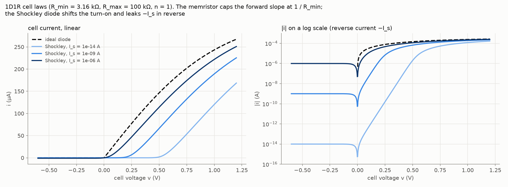
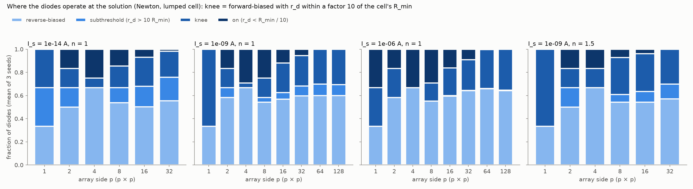
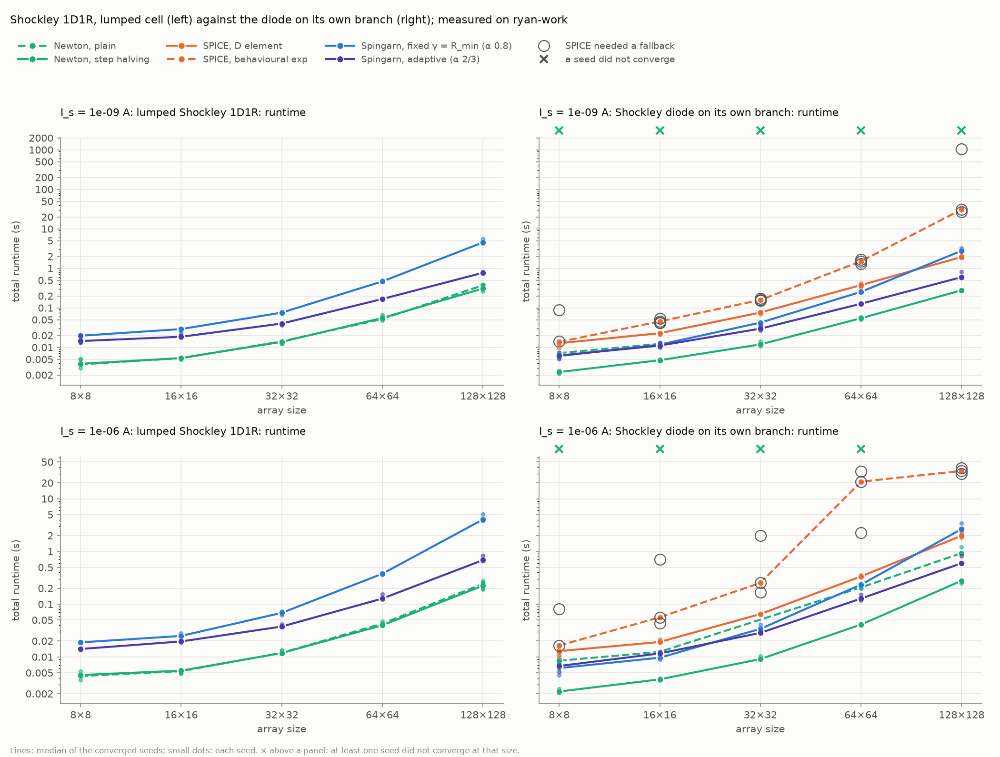
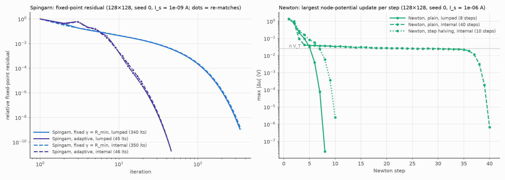
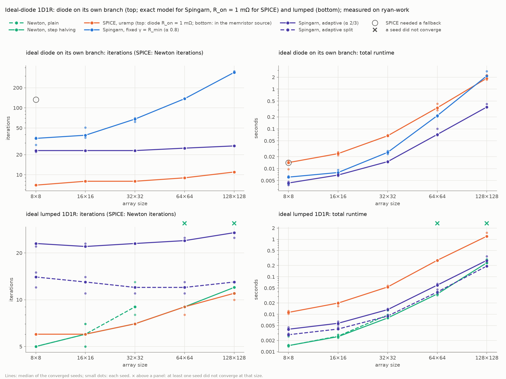
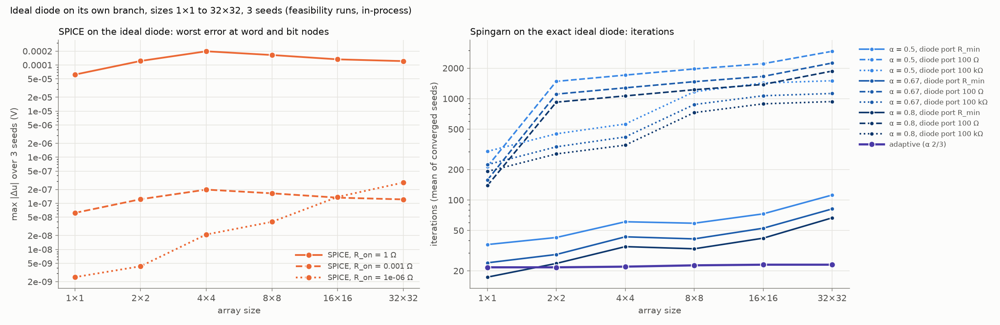
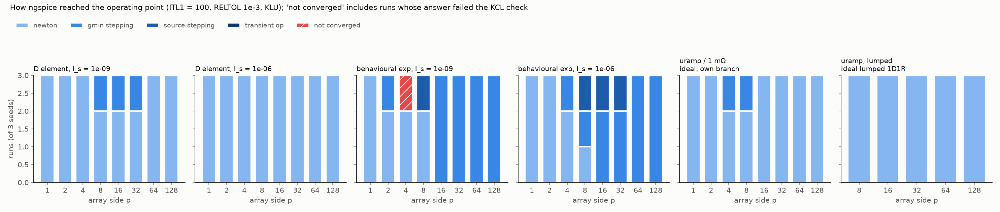

# Diode models in the 1D1R crossbar

*2026-10-14. Follows [report_nonsmooth.md](report_nonsmooth.md) §2 and [report_adaptive_matching.md](report_adaptive_matching.md). It tests how the diode law (Shockley or ideal) and the formulation (lumped cell, or diode on a branch of its own through an internal node) change the Newton-versus-Spingarn comparison. It also measures the Newton baseline on our own factorization that report_adaptive_matching.md §4 asked for.*

*Every runtime here was measured on the laptop (ryan-work: Intel Core Ultra 7 256V, 15.5 GB RAM), plugged in, in "Best performance" mode, in two back-to-back sweeps. Runtimes compare within this report only. Iteration counts don't depend on the machine.*

## 1. Overview

**Theory, briefly**
- A lumped 1D1R cell (diode in series with the memristor) has its slope capped at 1/R_min by the memristor. Its law is single-valued and Lipschitz, and its Jacobian A·G·Aᵀ is always positive definite, so Newton acts like an active-set method on the kink.
- Spingarn's a priori bound is 1 for any 1D1R cell, since a blocked cell reflects +1. With fixed matching the slow mode lives on rows of blocked cells and grows with size. Adaptive matching removes it by matching blocked cells as open circuits (report_adaptive_matching.md).
- What hurts Newton is a linear model that is wrong over the step taken. The Shockley conductance rises e-fold per n·V_T ≈ 26 mV, so unlimited Newton overshoots and crawls back by about n·V_T per step. SPICE's `D` element limits the junction voltage (pnjlim); a behavioural `exp()` source doesn't.
- A conducting ideal diode on its own branch is a short: Newton can't stamp it, so SPICE needs a regularized `uramp(V)/R_on`. In Spingarn it reflects b = −|a|, i.e. −1 conducting and +1 blocking, against any port resistance.
- The Shockley diode's sector is unbounded, [0, ∞): in deep reverse r_d = n·V_T/(i + I_s) → ∞. A lumped Shockley cell's sector is [R_min, ∞), like the ideal 1D1R's.

**Headline results**
- **Newton on our own CHOLMOD factorization, with step halving, is the fastest solver in every case it can run** (§3). That excludes the ideal diode on its own branch, which has no finite Jacobian. At 128×128 it takes 0.20–0.33 s in 7–12 iterations:
  - against adaptive Spingarn's 0.26–0.82 s, a tie on the ideal lumped 1D1R and 2.1–3× faster on the Shockley cells;
  - and against SPICE's 1.2–2.3 s.

  So adaptive Spingarn's 3–7× lead over SPICE in report_adaptive_matching.md came from the linear solver and ngspice's overheads, not from the iteration.
- **Plain, undamped Newton on our factorization is not a usable baseline** (§3.2, §3.4):
  - On the ideal lumped 1D1R it 2-cycles at the kink from 64×64 up: 3 of 3 seeds fail, with the step stuck at 2.0–2.3 V.
  - With a Shockley diode on its own branch it either crawls at n·V_T per step (40–42 iterations) or overshoots to conductances ~1e14 S, where the Cholesky factorization breaks down. Which of the two happens depends on rounding.

  One step-halving rule fixes all of these: 7–12 iterations, flat in size.
- **The behavioural `exp()` diode is SPICE's weak point, as predicted, and worse** (§3.2):
  - a fallback (gmin or source stepping) in every run from 16×16 up, and up to 2836 iterations;
  - at 128×128, 27–1047 s (I_s 1e-9) or 30–39 s (1e-6), mostly KLU re-ordering and refactorization, and up to 1.1 GB;
  - one false convergence at 4×4: ngspice declared success at node potentials of 4e71 V. That passed our KCL check until this work fixed it (§2).
- **SPICE's `D` element converges, but it is not the Shockley law** (§3.2):
  - 13–17 Newton iterations, with gmin stepping in 1 of 3 seeds at 8×8 to 32×32 when I_s ≤ 1e-9. Raising ITL1 to 3000 doesn't help.
  - Below −3·n·V_T it uses SPICE3's cubic reverse-bias approximation, up to 0.4% of I_s off. At I_s = 1e-6 A that shifts the 128×128 solution by 1.3e-4 V, matched to 3 digits by a first-order prediction.
- **H3 was half wrong** (§3.3). On the exact ideal diode on its own branch, adaptive Spingarn needs 22–27 iterations, flat from 8×8 to 128×128, the same as on the lumped cell (25–27), and is 5× faster than SPICE at 128×128. Matching can't change a diode's own reflection, but it changes the network solve, and that is what sets the rate.
- **The formulation costs Spingarn nothing.** Lumped and internal node take the same iterations (fixed: 340–367 against 350–376 at 128×128; adaptive: 45–46 against 46). The internal node is even cheaper per iteration, because the diode's resolvent is closed-form (Wright ω) instead of a nested series solve.

## 2. Setup

| | |
|---|---|
| circuit | 1D1R of report_nonsmooth.md §2: E ∈ [−1, 1.5] V; R_min 1–10 kΩ, R_max 50–200 kΩ per cell; wires 5 Ω, sources 50 Ω, loads 1 kΩ |
| cases | 1: lumped Shockley cell (`device="1d1r_shockley"`). 2: Shockley diode on its own branch (`internal_node=True`). 3: ideal diode on its own branch (`device="1d1r", internal_node=True`). Plus the ideal lumped 1D1R, for the Newton baseline |
| diode | Shockley i = I_s·expm1(v/(n·V_T)), V_T = 25.85 mV. Feasibility: (I_s, n) = (1e-14, 1), (1e-9, 1), (1e-6, 1), (1e-9, 1.5). Scaling: I_s 1e-9 (all cases) and 1e-6 (Shockley cases), n = 1 |
| Newton | `newton` (plain) and `newton_safeguarded` (step halving until ‖KCL residual‖₂ decreases, at most 30 halvings): CHOLMOD with nested dissection, `refactor` each step, the shared KCL test at tol 1e-9 / abstol 1 pA |
| SPICE | ngspice-47 with KLU, RELTOL 1e-3, ITL1 100. Case 2: `D` element (`spice`) or behavioural exp (`spice_exp`). Case 3: `uramp(V)/R_on`, with R_on 1 Ω, 1 mΩ and 1 µΩ in feasibility and 1 mΩ in scaling |
| Spingarn | fixed: γ = R_min for cells and diodes, α 0.8. Adaptive: α 2/3 (defaults of report_adaptive_matching.md; diodes re-matched within [1 Ω, 10⁸ Ω]). Feasibility also ran split adaptive, and on case 3 α ∈ {0.5, 2/3, 0.8} × diode port {100 Ω, R_min, 100 kΩ} |
| sizes, seeds | feasibility 1×1 to 32×32, in-process; scaling 8×8 to 128×128 (your cap for this run), runner-isolated with a 1800 s timeout; seeds 0–2 |
| machine | the laptop, AC and "Best performance"; no timeouts or crashes |

**What changed in the code** (files table in §5):
- **Topology.** `internal_node` adds pq internal nodes and pq diode branches in a new DIODE block after LOAD, so every existing branch block is unchanged.
- **Ideal diodes on their own branch.** They are set-valued, so `Config.current` gives both branches of a cell its lumped current, which is exact at a solution, and `Config.conductance` refuses.
- **Ordering.** Internal nodes are eliminated first. That adds exactly 3pq entries to the factor and no other fill (checked by `lnz`, 1×1 to 64×64).
- **The KCL test now rejects non-finite residuals.** Before, ∞ ≤ RELTOL·∞ passed (§3.2). Existing results are unaffected.
- **SPICE's own law.** Runs are judged against the law ngspice was actually given (its diode element, the regularized ideal diode); the residual under the exact law is recorded beside it.
- **Bit-identity.** Every existing solver is bit-identical: iterations and v, i hashes for spingarn, spingarn_sector, spingarn_slu, the adaptive and split variants, condat_vu and scellier_lines, on memristor, 1D1R and 1S1R circuits at 24×20, seed 5.
- **Tests.** 89 pass across the eight test files (19 new, including the new test_newton.py).

## 3. Results

### 3.0 Cell laws and where the diodes operate



*Figure 1. Ideal and lumped Shockley 1D1R cells for a typical memristor. Linear current (left), log |i| (right).*



*Figure 2. Diode regimes at the solution (Newton, lumped cell), mean of 3 seeds. Knee: forward-biased with r_d within a factor 10 of the cell's R_min.*

| I_s, n | size | reverse | subthreshold | knee | on | output change vs ideal 1D1R | median forward diode voltage |
|---|---|---|---|---|---|---|---|
| 1e-14, 1 | 32×32 | 55% | 20% | 23% | 2% | 46–51% | 0.45 V |
| 1e-9, 1 | 32×32 | 60% | 9% | 26% | 6% | 23–26% | 0.25 V |
| 1e-9, 1 | 128×128 | 60% | 9% | 31% | 0% | 20–22% | 0.23 V |
| 1e-6, 1 | 32×32 | 64% | 0% | 27% | 9% | 10–11% | 0.09 V |
| 1e-6, 1 | 128×128 | 64% | 0% | 35% | 0% | 10–12% | 0.06 V |
| 1e-9, 1.5 | 32×32 | 57% | 13% | 30% | 0% | 34–38% | 0.34 V |

*Output change: relative change of the bit-line output currents from the ideal-diode 1D1R, same seed; range over seeds.*

- **The knee is exercised at every size and every I_s.** From 64×64 up no diode is "on": the conducting ones sit in the knee (30–35%) or, at I_s 1e-9, subthreshold (9–10%). Loading pulls cell voltages down with size (report_nonsmooth.md §2.5), so at scale the circuit tests the curved part of the diode, not the kink.
- **I_s = 1e-14 (silicon) is mostly subthreshold.** Forward diodes sit at ~0.45–0.6 V and half the output current disappears against the ideal diode. That is why the scaling runs used 1e-9 and 1e-6.

### 3.1 Case 1: lumped Shockley cell


*Figure 3. Shockley 1D1R, iterations (SPICE: Newton iterations). Lumped cell (left) and diode on its own branch (right), I_s 1e-9 (top) and 1e-6 (bottom). Lines: median of 3 seeds, dots: each seed. Rings: SPICE needed a fallback. ×: a seed did not converge.*



*Figure 4. The same, total runtime.*

| 128×128 | I_s 1e-9: iterations | runtime | I_s 1e-6: iterations | runtime |
|---|---|---|---|---|
| Newton, plain | 11–12 | 0.33–0.39 s | 7–8 | 0.19–0.28 s |
| Newton, step halving | 9 (1 halving) | 0.26–0.33 s | 7–8 (none) | 0.20–0.26 s |
| Spingarn fixed (α 0.8) | 340–367 | 4.3–5.5 s | 306–324 | 3.8–5.1 s |
| Spingarn adaptive (α 2/3) | 45–46 (8–9 re-matches) | 0.75–0.82 s | 40 (6–7 re-matches) | 0.67–0.83 s |

*Ranges over seeds 0–2. SPICE can't express the lumped law.*

- **Newton converges fast on the lumped Shockley cell**, as on the ideal one. It takes 4–5 iterations at 8×8 and 7–12 at 128×128, and plain Newton never failed. The safeguard halved once per run from 64×64 up at I_s 1e-9, saving up to 3 iterations.
- **Fixed-matching Spingarn slows with size exactly as on the ideal 1D1R:** 35–37 iterations at 8×8, 306–367 at 128×128. The ideal lumped cell took 325–342 at 128×128 in report_nonsmooth.md. The smoother diode buys nothing.
- **Adaptive matching restores near-flat counts, a little worse than on the ideal cell.** It takes 22–31 iterations at 8×8 and 40–46 at 128×128, against 25–27 on the ideal lumped cell. Subthreshold and knee cells have finite, iterate-dependent incremental resistances, so they are re-matched more often (6–9 times against 7).
- **Split adaptive was dropped after feasibility.** On Shockley cells it failed on most circuits at 32×32 (0–2 of 3 converged, the rest crawling past 1000 iterations). With I_s = 1e-6, reverse cells of 1e6–1e8 Ω are re-matched rather than opened and then run at α = 1 against a near-short network.

### 3.2 Case 2: Shockley diode on its own branch

| 128×128 | I_s 1e-9: iterations | runtime | I_s 1e-6: iterations | runtime |
|---|---|---|---|---|
| Newton, plain | fails 3/3 (Cholesky) | – | 40–42 | 0.90–1.22 s |
| Newton, step halving | 10 (2 halvings) | 0.28 s | 8–10 (2–3 halvings) | 0.25–0.29 s |
| SPICE, `D` element | 17, plain Newton | 1.89–2.10 s | 17, plain Newton | 1.85–2.31 s |
| SPICE, behavioural exp | 86–90, gmin stepping | 27–1047 s | 99–103, gmin stepping | 30–39 s |
| Spingarn fixed | 350–376 | 2.7–3.3 s | 316–334 | 2.5–3.4 s |
| Spingarn adaptive | 46 (9–11 re-matches) | 0.57–0.82 s | 46–47 (9–10) | 0.59–0.82 s |



*Figure 5. 128×128, seed 0. Left: Spingarn's fixed-point residual, lumped (solid) against internal node (dashed), I_s 1e-9; dots mark re-matches. Right: Newton's largest potential update per step, I_s 1e-6, where plain Newton on the internal node converged at this size.*

- **Unlimited Newton overshoots the exponential exactly as predicted** (Figure 5, right):
  - The first step drives diodes to ~1 V. Plain Newton then crawls back at n·V_T per step: 35 steps at ~26 mV, then quadratic convergence, 40–42 in all.
  - When the overshoot is larger, conductances reach ~1e14 S beside 1e-4 S memristors. Eliminating the internal node then cancels catastrophically and CHOLMOD reports a non-positive pivot: plain Newton failed at every size from 32×32 at I_s 1e-9 and in 7 of 15 runs at I_s 1e-6.
  - Which of the two happens depends on rounding: the same circuit flipped between them when the Jacobian's assembly changed.
- **Step halving removes the problem.** It takes 7–11 iterations with 2–3 halvings, flat from 8×8 to 128×128. That is more than on the lumped cell at small sizes (8–10 against 4–5 at 8×8) and about the same at 128×128 (8–10 against 7–9).
- **SPICE's `D` element works, mostly by plain Newton.**
  - It takes 13–17 iterations, 1.5–2× the lumped ideal SPICE's 10–11.
  - At I_s ≤ 1e-9, 1 of 3 seeds at 8×8 to 32×32 (and 1 of 8 seeds at 4×4 in a separate probe) stalls in plain Newton and finishes by gmin stepping (Figure 8). Raising ITL1 to 300, 1000 or 3000 never lets plain Newton converge, so it is a stall, not a crawl.
  - With gmin and source stepping disabled, the transient-op fallback fails too. Why limited Newton stalls isn't established; a limit cycle of pnjlim is a guess. ngspice doesn't expose its iterates.
- **SPICE's `D` element solves a slightly different circuit.** Measured on ngspice-47:
  - its thermal voltage is 25.865 mV (27 °C), which the netlist compensates through N;
  - it puts gmin = 1e-12 S across every junction, which at I_s = 1e-14 is 100× the saturation current at 1 V reverse bias;
  - below −3·n·V_T it uses SPICE3's cubic reverse-bias approximation, up to 0.4% of I_s off the exponential.

  At I_s = 1e-6 A that last effect alone moves the solution by 3.7e-5 V at 64×64 and 1.3e-4 V at 128×128. A first-order prediction from the exact solution reproduces both to 3 digits (correlation 1.0000). SPICE's runs are therefore judged on that law, and the exact-law residual (4e-9 A) is recorded beside it.
- **The behavioural `exp()` diode is where SPICE struggles:**
  - a fallback in every run from 16×16 up: gmin stepping, plus source stepping in 4 scaling runs at 8×8 to 32×32; up to 2836 iterations;
  - 86–103 iterations at 128×128, but 27–1047 s (I_s 1e-9) or 30–39 s (1e-6) and 0.4–1.1 GB, against 2 s and 0.34 GB for the `D` element. At I_s 1e-9 most of that time is KLU re-analysing the matrix (17–1039 s of re-ordering), as the exponential's dynamic range forces new pivots; at 1e-6 it is refactorization (18–32 s);
  - ngspice clamps `exp()` in behavioural sources at 1e99, flat above an argument of 227.96 (measured), so it can't overflow, but the slope vanishes there. At 4×4, seed 1, I_s 1e-9, ngspice declared plain-Newton convergence at node potentials of 4e71 V.

  Our KCL check passed that point, because ∞ ≤ RELTOL·∞. It now requires finite residuals, and the run is recorded as not converged (Figure 8). Accuracy where it converges is 8e-6 to 3e-5 V at word/bit nodes, which RELTOL 1e-3 allows.
- **Spingarn is robust, as predicted.** Every run converged; nothing overshoots or overflows.
  - Fixed matching is as slow as on the lumped cell: 350–376 against 340–367 iterations at 128×128.
  - Adaptive takes 46–47 iterations with 9–11 refactorizations against Newton's 8–10: "Newton-like refactorization counts", as predicted. Each Spingarn iteration still costs a solve plus the per-branch work, so adaptive is 2.1× slower than step-halving Newton.
  - Lumped and internal-node residual histories coincide (Figure 5, left). The diode's closed-form resolvent makes the internal node cheaper per iteration: fixed 2.8 s against 4.5 s at 128×128.

### 3.3 Case 3: ideal diode on its own branch



*Figure 6. Ideal-diode 1D1R. Top: diode on its own branch (Spingarn exact, SPICE with R_on = 1 mΩ). Bottom: the lumped cell. Iterations (left) and runtime (right); median and seeds as in Figure 3.*



*Figure 7. Ideal diode on its own branch, feasibility runs (1×1 to 32×32, 3 seeds). Left: SPICE's worst error at word/bit nodes against the exact solution, per R_on. Right: Spingarn's iterations per relaxation and diode port resistance.*

| 128×128 | iterations | runtime | worst max \|Δu\| vs exact, sizes ≥ 32 |
|---|---|---|---|
| SPICE, uramp / 1 mΩ | 11, plain Newton | 1.73–2.27 s | 1.2e-7 V |
| Spingarn fixed (α 0.8, diode port R_min) | 336–352 | 2.11–2.81 s | 2.0e-8 V |
| Spingarn adaptive (α 2/3) | 27 (6–7 re-matches) | 0.35–0.42 s | 7.6e-10 V |

- **SPICE's regularized diode converges easily.** Plain Newton takes 7–11 iterations. gmin stepping appeared in 1 of 3 seeds at 8×8 in scaling, and at every R_on in 1 of 3 seeds at 4×4 and 8×8 in feasibility.
- **Its accuracy stops improving below R_on = 1 mΩ.** At 32×32 the error is 1.2e-4 V at 1 Ω and 1.2e-7 V at 1 mΩ, proportional to R_on, but 2.8e-7 V at 1 µΩ, worse than at 1 mΩ. Below 1 mΩ the ill-conditioning and RELTOL dominate.
- **Spingarn on the exact model.**
  - Fixed matching grows with size as on the lumped cell: 28–36 iterations at 8×8 and 336–352 at 128×128, against 325–342 lumped (report_nonsmooth.md).
  - The diode's port resistance matters a lot (Figure 7). At 32×32, port = R_min gives 62–117 iterations (α 0.8 to 0.5), 100 kΩ gives 900–1560, and 100 Ω gives 1791–2994 (one α 0.5 run hit the 3000 budget).
  - α < 1 is required, as predicted. The split variant (α = 1 on everything not open) stalls even at 1×1: its fixed-point residual sits at 3e-4, the −1 mode of a conducting diode.
- **Adaptive matching works on the exact ideal diode, against H3.**
  - It takes 22–23 iterations at 8×8 and 27 at 128×128, the same as on the lumped cell (25–27), at 0.35–0.42 s against SPICE's 1.7–2.3 s.
  - What it does: blocked diodes get 10⁸ Ω and conducting ones the 1 Ω floor. That doesn't change any diode's own reflection (still ±1), but it makes the network solve treat blocked diodes as open, which removes the slow row mode. α = 2/3 then maps the conducting diodes' −1 to −1/3.

### 3.4 The Newton baseline on our factorization (ideal lumped 1D1R)

| 128×128 | iterations | runtime |
|---|---|---|
| Newton, plain | fails 3/3 (2-cycle) from 64×64 | – |
| Newton, step halving | 11–12 (2–5 halvings) | 0.23–0.29 s |
| SPICE | 10–11 | 1.21–1.51 s |
| Spingarn adaptive | 25–27 (7 re-matches) | 0.26–0.36 s |
| Spingarn adaptive split | 13 (5 re-matches) | 0.19–0.26 s |

- **This is the experiment report_adaptive_matching.md §4 called deciding, and it goes against attributing the speedup to Spingarn.** On the same CHOLMOD and nested-dissection factorization, step-halving Newton ties adaptive Spingarn and is 1.2× slower than split. All three are 4–6× faster than ngspice, so the earlier speedup over SPICE belongs to the linear algebra and ngspice's overheads.
- **Plain undamped Newton on our factorization 2-cycles on the ideal lumped 1D1R from 64×64**: the step stays at exactly 2.0 V (2.3 V at 128×128) and the KCL residual never moves. SPICE's plain Newton converges on the same circuits in 8–11 iterations, so something in its iteration avoids the cycle (not established). One or two halvings per run break it.
- **Memory at 128×128:** 0.13–0.15 GB for Newton and Spingarn, 0.30 GB for SPICE.

### 3.5 How SPICE reached its operating points



*Figure 8. ngspice's route to the operating point per size: feasibility runs up to 32×32 and scaling runs from 8×8 (where both exist, the scaling run's). "Not converged" includes the exp run whose answer failed the KCL check.*

### 3.6 Accuracy

- **Word/bit potentials agree** with Newton on the lumped cell, at sizes ≥ 32×32:
  - Spingarn fixed ≤ 2e-8 V, adaptive ≤ 3e-9 V, split ≤ 4e-10 V, Newton ≤ 2e-9 V;
  - SPICE: `D` 1.3e-7 V at I_s 1e-9 but 1.3e-4 V at 1e-6 (its reverse law, §3.2), exp 8e-6 to 3e-5 V, uramp/1 mΩ 1.2e-7 V.
- **Absolute KCL residuals**, each solver's own recorded test (relative ones are meaningless on 1D1R's dead lines):
  - Spingarn ≤ 1.4e-12 A, at the 1 pA abstol;
  - Newton ≤ 6.4e-13 A;
  - SPICE ≤ 6e-13 A under its own laws, except exp at 2e-7 to 5e-7 A, which passes RELTOL 1e-3. Under the exact laws: `D` 4e-12 A (I_s 1e-9) and 4e-9 A (1e-6), uramp 3e-10 A.

## 4. Which predictions held

- **H1 (lumped Shockley): held.**
  - Newton is fast: 7–12 iterations at 128×128, no failures.
  - Fixed Spingarn slows with size just as with the ideal diode.
  - Adaptive matching restores near-flat counts, 40–46, though about 1.7× the ideal cell's 25–27.
  - The smoother diode buys Spingarn nothing.
- **H2 (Shockley on its own branch): held in substance, with three corrections.**
  - SPICE's `D` element converges with more iterations than the lumped ideal cell (17 against 10–11). But at I_s ≤ 1e-9 it needs gmin stepping on about 1 seed in 3 at 4×4 to 32×32, where plain Newton stalls. It also solves a slightly different law: a 1.3e-4 V shift at I_s 1e-6.
  - The behavioural exp struggles, worse than predicted: fallbacks on every run at scale, 27–1047 s, and one false convergence that our KCL check missed until now.
  - Spingarn is robust and refactorizes about as often as Newton (9–11 against 8–10). But step-halving Newton on the same factorization beats it 2.1×, so the predicted robustness advantage doesn't turn into a speed advantage.
  - Not in the predictions: unlimited Newton (ours) crawls at n·V_T per step or breaks Cholesky, and one step-halving rule fixes it completely.
- **H3 (ideal on its own branch): half held.**
  - SPICE can't represent the diode exactly. With uramp/R_on it converged easily, Newton failures were rare (one gmin-stepping seed at 8×8), and accuracy stops improving below R_on = 1 mΩ.
  - Spingarn: every diode reflects fully, α < 1 is required, and fixed matching is size-dependent. All as predicted.
  - **Wrong:** "matching can't help". The diode port resistance changes fixed matching's count 15-fold, and adaptive matching gives 22–27 iterations flat, the fastest solver on this case.

## 5. Limitations

- **Measurements.**
  - One machine (the laptop) and 3 seeds per configuration.
  - Sizes up to 128×128, your choice for this run; 256×256 and above aren't measured.
  - Single seeds varied up to 1.4× in runtime at equal iteration counts, as in earlier reports. SPICE exp's 1047 s run is one seed among 27 s and 31 s.
- **What isn't explained.**
  - Why SPICE's limited Newton (`D` at I_s ≤ 1e-9, uramp on the internal node) stalls, and why SPICE's plain Newton avoids the 2-cycle ours falls into on the lumped ideal cell. ngspice doesn't expose its iterates. Replicating pnjlim in our Newton would test it.
  - Whether plain Newton crawls or breaks Cholesky depends on rounding.
- **Settings chosen on these circuits.**
  - The fixed diode port (R_min) was chosen from feasibility at ≤ 32×32.
  - Adaptive Spingarn ran with report_adaptive_matching.md's defaults, plus a 1 Ω diode floor that wasn't tuned.
  - The regime definitions (factor-10 knee band) are a choice.
- **Accuracy is not matched across solvers.** Newton overshoots the tolerance, as SPICE does; adaptive Spingarn stops near the 1 pA abstol.
- **Split adaptive** has no convergence proof, and here it failed on Shockley cells and on ideal internal-node diodes.

## 6. Reproduction

```
python -X utf8 diode_models_experiment.py feasibility --out results/diode-models-feasibility
python -X utf8 diode_models_experiment.py scale --sizes 8 16 32 64 128 --seeds 3 --timeout 1800 --diode 1e-9 1 --out results/diode-models-scale-Is1e-9
python -X utf8 diode_models_experiment.py scale --sizes 8 16 32 64 128 --seeds 3 --timeout 1800 --diode 1e-6 1 --cases lumped internal --out results/diode-models-scale-Is1e-6
python -X utf8 diode_models_figures.py
```

The two scaling sweeps ran back to back on the laptop, plugged in and in "Best performance", with nothing else running. The feasibility run's timings aren't used.

**Files changed**

| file | change |
|---|---|
| [devices.py](devices.py) | Shockley law and conductance; `shockley_resolvent` (Wright ω or linearized start, 4 Newton steps, ≤ 1.2e-14 relative residual); `diode_series_solve` for the lumped cell |
| [Config.py](Config.py) | device `1d1r_shockley` (I_s, n, V_T); `internal_node` topology with a DIODE block; `device_law`/`diode_law`; `mid_node`; `line_potentials`; laws and conductances for the new cells |
| [algorithms/ordering.py](algorithms/ordering.py) | internal nodes first |
| [algorithms/common.py](algorithms/common.py) | `kcl_check` takes an optional law and requires finite residuals |
| [algorithms/spingarns.py](algorithms/spingarns.py) | `diode_gamma` rules and `diode_resolvent`; adaptive re-matching of diodes (`diode_floor`); series-cell warm starts for the lumped Shockley cell |
| [algorithms/newton.py](algorithms/newton.py) (new) | `newton`, `newton_safeguarded` on CHOLMOD + nested dissection, fixed-pattern Jacobian |
| [algorithms/spice.py](algorithms/spice.py) | internal-node netlists (`D`, exp, uramp/R_on); `spice_diode_current`; KCL against the as-solved law; `spice_exp` |
| [algorithms/condat_vu.py](algorithms/condat_vu.py), [algorithms/scellier.py](algorithms/scellier.py) | refuse internal-node and lumped Shockley circuits |
| [algorithms/\_\_init\_\_.py](algorithms/__init__.py) | registers `newton`, `newton_safeguarded`, `spice_exp` |
| [testing/](testing/) | 19 new tests (test_config 4, test_ordering 1, test_spingarn 4, test_spice 4, new test_newton.py 6) and updated pinned option dicts |
| [diode_models_experiment.py](diode_models_experiment.py), [diode_models_figures.py](diode_models_figures.py) (new) | this report's runs, figures and tables |
