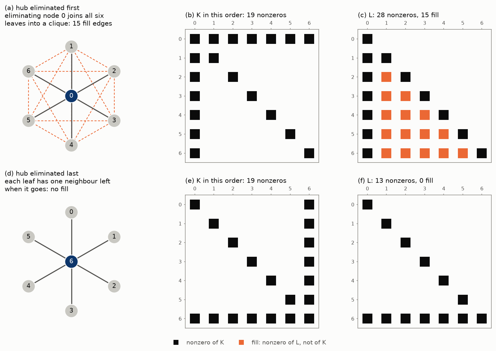
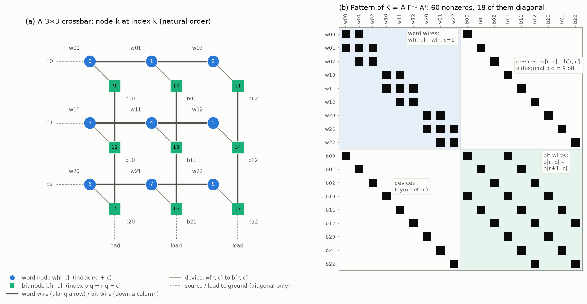
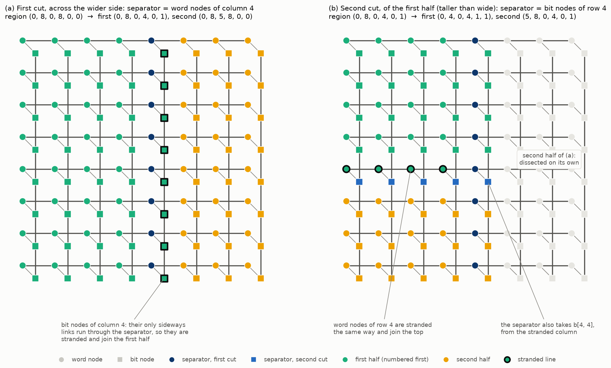
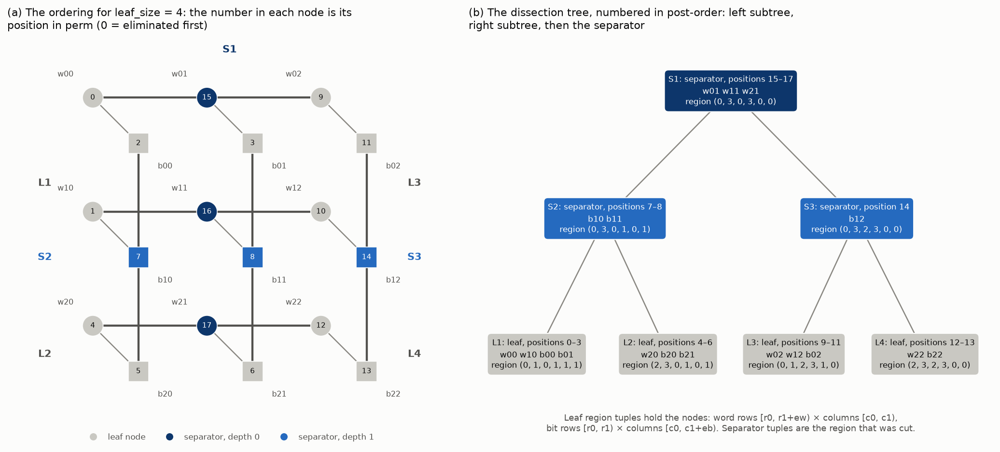
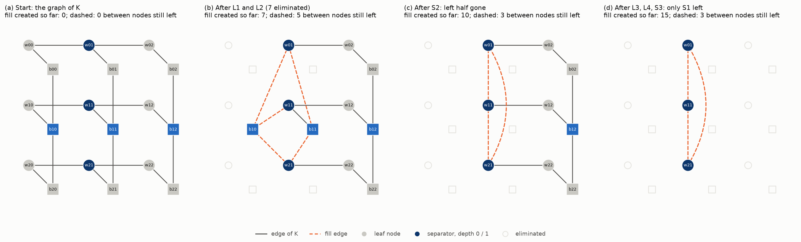
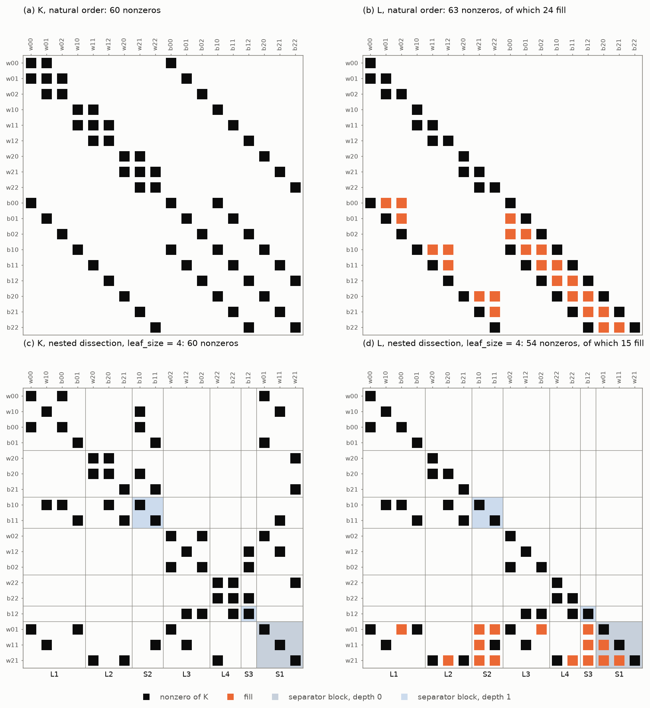
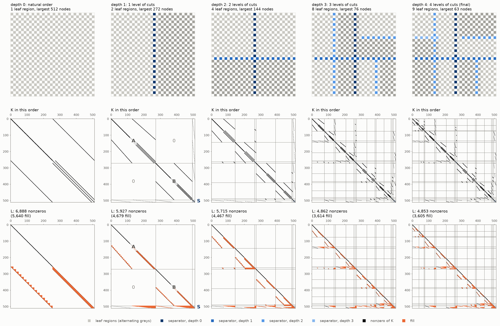
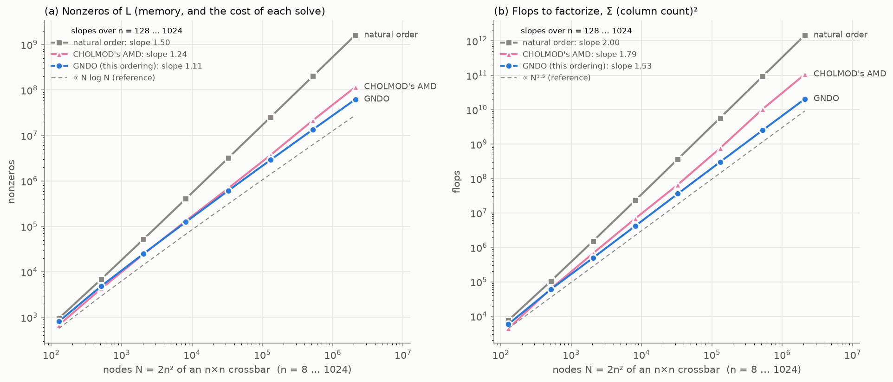

# Geometric nested dissection: how the crossbar's nodal matrix is ordered

*2026-10-10. Explains the ordering in [algorithms/ordering.py](algorithms/ordering.py), which the default Spingarn solvers use to factorize the nodal matrix (report.md §6). Written for readers who know basic graph theory, Cholesky factorization and sparse matrix storage, but haven't worked with fill-reducing orderings. Every figure comes from [nested_dissection_figures.py](nested_dissection_figures.py).*

*Every count here (nonzeros, fill, flops) is structural: it depends only on the array's shape, never on circuit values, seeds or the machine. The only timings quoted are from report.md §6, measured on the laptop (Intel Core Ultra 7 256V).*

## Summary

- **The problem.** Spingarn's method solves one linear system with the nodal matrix $K = A\,\Gamma^{-1}A^T$ in every iteration. $K$ is factorized once as $K = LL^T$, and each iteration then costs two triangular solves. How many nonzeros $L$ has depends entirely on the order in which the nodes are eliminated:
  - in the natural numbering, a 1024×1024 array's $L$ has 1.6 billion nonzeros, about 13 GB for the values alone;
  - in the geometric nested-dissection ordering (GNDO) it has 62 million.
- **The idea (§1).** Eliminating a node joins all its remaining neighbours to each other, and those new edges are the *fill*. If a small set of nodes $S$ (a *separator*) splits the graph into two halves $A$ and $B$, and $S$ is numbered after both, then no fill ever joins $A$ to $B$. The factorizations of $A$ and $B$ become independent, and each half can be split the same way, recursively.
- **The geometric part (§2–3).** Separators on the crossbar can be read off the grid rather than searched for:
  - only word wires run between columns, so a vertical cut needs only the word nodes of one column;
  - only bit wires run between rows, so a horizontal cut needs only the bit nodes of one row.
  
  Each cut strands the other kind of node on its line, and the code tracks this with two flags per region.
- **The algorithm (§4).** Cut the region across its longer side, at the middle. Number the first half, then the second half, then the separator. Stop at regions of at most 64 nodes, which are numbered in natural order. The whole thing is 96 lines and computes the ordering for 2 million nodes in about 0.13 s (report.md §6.3, laptop).
- **A worked example (§5).** On a 3×3 crossbar (18 nodes), the recursion takes seven steps. GNDO creates 15 fill entries against 24 for the natural order, and every one of them can be checked by hand.
- **Scaling (§7–8).** Measured from $n = 128$ to $n = 1024$:
  - GNDO's $L$ grows as $N^{1.11}$, close to the $N \log N$ that theory predicts, and its flops as $N^{1.53}$, against the theoretical $N^{1.5}$.
  - CHOLMOD's own AMD ordering grows as $N^{1.24}$ and $N^{1.79}$.
  - The natural order grows as $N^{1.50}$ and $N^{2.00}$.
  
  At 1024×1024, GNDO needs 1.9× fewer nonzeros and 5.2× fewer flops than AMD. On small arrays (32×32 and below) AMD's $L$ has slightly fewer nonzeros, but those arrays take milliseconds either way.

---

## 1. Why the order matters

### 1.1 One factorization, many solves

Each Spingarn iteration projects onto the KVL/KCL subspaces by solving $K x = r$, where

$$K = A\,\Gamma^{-1}A^T$$

- $A$ is the reduced incidence matrix (one row per node, one column per branch), and
- $\Gamma$ is the diagonal matrix of port resistances.

$K$ is symmetric positive definite and does not change between iterations. So the solver factorizes it once, as $K = LL^T$ with $L$ lower triangular (Cholesky, via CHOLMOD), and then solves $Ly = r$ and $L^T x = y$ in every iteration. Three costs follow from $L$:

| cost | grows with |
|---|---|
| memory to store $L$ | $\text{nnz}(L)$, the number of nonzeros of $L$ |
| each pair of triangular solves | $\text{nnz}(L)$ |
| the factorization itself | about $\sum_j c_j^2$, where $c_j$ is the number of nonzeros in column $j$ of $L$ |

$K$ itself is very sparse. Each node touches at most 3 others, so a 1024×1024 crossbar's $K$ has 2.1 million rows and only 8.4 million nonzeros. $L$, however, has nonzeros wherever $K$ does, plus extra *fill* entries where $K$ is zero. How much fill there is depends on the order in which rows and columns are eliminated.

Reordering means factorizing $PKP^T$ instead of $K$, for a permutation matrix $P$. That is the same as renumbering the nodes. The answer of the linear system is unchanged, but $L$ can be very different. In the code an ordering is an index array `perm`, where `perm[k]` is the node eliminated $k$-th. The matrix actually factorized is `K[perm][:, perm]`.

### 1.2 Elimination as a graph game

Read $K$ as a graph: one vertex per node, and an edge $i$–$j$ wherever $K_{ij} \ne 0$. For the crossbar, this is just the circuit's own graph (§2).

The first step of Cholesky eliminates node 1. Write $K = \begin{pmatrix} d & \ell^T \\ \ell & K_2 \end{pmatrix}$. Then $L$'s first column is $\sqrt d$ on the diagonal with $\ell / \sqrt d$ below it, and what remains to factorize is the Schur complement

$$K_2 - \frac{\ell\,\ell^T}{d}.$$

$\ell\ell^T$ is nonzero at $(i, j)$ exactly when both $i$ and $j$ are neighbours of node 1. So, in graph terms:

> **Eliminating a node removes it from the graph and joins all of its remaining neighbours to each other, into a clique.** Each new edge is a fill entry of $L$. Column $k$ of $L$ is nonzero exactly at node $k$'s neighbours at the moment it is eliminated.

This "elimination game" ignores accidental cancellation, which is the standard assumption and is what CHOLMOD's symbolic analysis computes. It lets you predict $L$'s structure with pencil and paper, as §5 does.

### 1.3 A star, in two orders



*Figure 1. A star: one hub joined to six leaves. $K$ has the same 19 nonzeros in both orders; only the numbering differs.*
- *(a)–(c) Hub eliminated first. Its six neighbours become a clique: 15 fill edges (dashed), and $L$ is completely full.*
- *(d)–(f) Hub eliminated last. Each leaf has only the hub left as a neighbour when it goes, so there is no fill at all.*

The lesson is the one nested dissection is built on: **eliminate the nodes that connect things last.** A node that joins otherwise separate parts of the graph will, if eliminated early, merge those parts into one clique.

### 1.4 Separators, and why they stop fill

A **separator** of a graph is a set of nodes $S$ whose removal splits the remaining nodes into two parts $A$ and $B$, with no edge between $A$ and $B$. The result that makes separators useful is a characterization of fill:

> **Fill-path theorem** (Rose, Tarjan & Lueker, 1976). With nodes numbered in elimination order, $L_{ij} \ne 0$ (for $i > j$) exactly when the graph of $K$ has a path from $i$ to $j$ whose interior nodes are all numbered below $j$.

Number $A$ first, then $B$, then $S$, and take $a \in A$ and $b \in B$. Every path from $a$ to $b$ passes through $S$, whose nodes are numbered above both $a$ and $b$. So no path qualifies, and $L_{ba} = 0$. In block form:

$$
PKP^T = \begin{pmatrix} K_{AA} & 0 & K_{AS} \\ 0 & K_{BB} & K_{BS} \\ K_{SA} & K_{SB} & K_{SS} \end{pmatrix}
\quad\Longrightarrow\quad
L = \begin{pmatrix} L_{AA} & & \\ 0 & L_{BB} & \\ L_{SA} & L_{SB} & L_{SS} \end{pmatrix}
$$

Reading this block by block:

- $L_{AA}$ is the Cholesky factor of $K_{AA}$ alone, and $L_{BB}$ that of $K_{BB}$ alone. They are **two independent, smaller problems**.
- The zero block stays zero: fill never crosses between $A$ and $B$.
- $L_{SS}$ is the factor of the Schur complement $K_{SS} - L_{SA}L_{SA}^T - L_{SB}L_{SB}^T$, which is usually dense. That is the price of the separator, so separators should be **small**.

**Nested dissection** (George, 1973) applies this recursively: split the graph with a small separator, number the two halves first and the separator last, and order each half the same way.

---

## 2. The crossbar as a graph



*Figure 2. A 3×3 crossbar and its nodal matrix, in the natural numbering.*
- *(a) The graph. Word nodes are circles and bit nodes squares, each labelled with its index. Word and bit wires cross in the drawing without connecting. Sources and loads run to ground, which is not a node, so they only add to $K$'s diagonal.*
- *(b) The pattern of $K$: 60 nonzeros, the same for every $\Gamma$.*

`Config` numbers the $2pq$ nodes of a $p \times q$ crossbar as follows:

- **Word nodes** $w[r, c]$ get indices $0$ to $pq - 1$, row-major: index $rq + c$.
- **Bit nodes** $b[r, c]$ follow, also row-major: index $pq + rq + c$.

There are three kinds of edge:

| edge | joins | direction on the grid |
|---|---|---|
| word wire | $w[r, c]$ – $w[r, c+1]$ | along a row only |
| bit wire | $b[r, c]$ – $b[r+1, c]$ | down a column only |
| device | $w[r, c]$ – $b[r, c]$ | within one cross-point |

So the word layer is $p$ separate horizontal paths and the bit layer $q$ separate vertical paths, joined at every cross-point by a device. A useful way to picture it: take a $p \times q$ grid graph (each vertex joined to its 4 neighbours) and **split every vertex in two**. One half keeps the horizontal edges, the other half keeps the vertical edges, and a device joins the two halves. Contracting every device edge gives back the grid.

The pattern of $K$ (Figure 2b) shows this:
- the word block is tridiagonal (word wires);
- the bit block has bands $q$ off the diagonal (bit wires);
- the off-diagonal blocks are diagonals $pq$ off (devices).

Because the pattern depends only on $p$ and $q$, `nested_dissection(cfg)` reads nothing but `cfg.p` and `cfg.q`. The same ordering serves every device type, every $\Gamma$ rule and every seed.

---

## 3. Separators read off the grid

General-purpose nested dissection (METIS, for instance) has to *search* for small separators with a graph partitioner. On the crossbar the geometry hands them over.



*Figure 3. The first two cuts of an 8×8 crossbar. Circles are word nodes and squares bit nodes.*
- *(a) The first cut takes the word nodes of column 4 (dark blue). The bit nodes of column 4 (ringed) are stranded and join the first half (green).*
- *(b) The first half is taller than wide, so it is cut horizontally through the bit nodes of row 4 (blue). The word nodes of row 4 (ringed) are stranded in turn. The separator takes $b[4, 4]$, cutting the column stranded in (a). The second half of (a) (faded) is dissected separately.*

### 3.1 Vertical and horizontal cuts

- **Vertical cut through column $c$.** The only edges between column $c-1$ and column $c+1$ are word wires, and every one of them passes through a word node $w[r, c]$. Removing the word nodes $w[:, c]$ disconnects everything left of column $c$ from everything right of it. The bit nodes of column $c$ don't need to be removed. **A vertical separator is one column of word nodes**: $p$ nodes, not $2p$.
- **Horizontal cut through row $r$.** By the same argument with the roles swapped, the bit nodes $b[r, :]$ suffice. **A horizontal separator is one row of bit nodes**: $q$ nodes.

So a separator of the crossbar is exactly as large as the matching separator of the underlying $p \times q$ grid, even though the crossbar has two nodes per cross-point.

### 3.2 Stranded lines

After a vertical cut through column $c$, consider the bit nodes $b[:, c]$ that stayed behind. Each one has three neighbours: the bit nodes above and below it, in the same column, and the separator node $w[r, c]$. So the column $b[:, c]$ forms a path that touches **neither** half; it hangs off the separator alone.

Such a *stranded* line can go into either half, since it creates no edge between them. The code puts it in the first half: the left half for a vertical cut, the top half for a horizontal cut, where the stranded line is a row of word nodes. Later cuts in that half split it like any other nodes. Figure 3b shows this: the second cut's separator $b[4, 0..4]$ includes $b[4, 4]$, a node of the column stranded by the first cut.

### 3.3 Regions: the six-number tuple

Stranded lines make regions slightly irregular: a region can have one extra row of word nodes or one extra column of bit nodes. The code describes a region by six integers:

$$(r_0,\ r_1,\ c_0,\ c_1,\ e_w,\ e_b)$$

| part of the region | rows | columns |
|---|---|---|
| word nodes | $[r_0,\ r_1 + e_w)$ | $[c_0,\ c_1)$ |
| bit nodes | $[r_0,\ r_1)$ | $[c_0,\ c_1 + e_b)$ |

$e_w \in \{0, 1\}$ marks a stranded word row below the region's rows, and $e_b \in \{0, 1\}$ a stranded bit column to its right. The whole array is $(0, p, 0, q, 0, 0)$. The node count is

$$\text{count} = (r_1 + e_w - r_0)(c_1 - c_0) + (r_1 - r_0)(c_1 + e_b - c_0),$$

which is `_count` in the code.

Figure 3's tuples work out as follows:

- **First cut.** The array $(0, 8, 0, 8, 0, 0)$ is cut at column 4, giving
  - first half $(0, 8, 0, 4, 0, 1)$: word columns 0–3, plus bit column 4 stranded, so $e_b = 1$;
  - second half $(0, 8, 5, 8, 0, 0)$.
- **Second cut.** The first half is then cut at row 4, giving
  - top $(0, 4, 0, 4, 1, 1)$: word row 4 is stranded, so $e_w = 1$, and the stranded bit column is still there, so $e_b = 1$;
  - bottom $(5, 8, 0, 4, 0, 1)$.

---

## 4. The algorithm, line by line

### 4.1 The recursion

```python
def nested_dissection(cfg, leaf_size=LEAF_SIZE):
    blocks = []

    def dissect(region):
        if _count(region) <= leaf_size:
            blocks.extend(_leaf_blocks(cfg, region))
            return
        separator, first, second = _split(cfg, region)
        dissect(first)
        dissect(second)
        blocks.append(separator)

    dissect((0, cfg.p, 0, cfg.q, 0, 0))
    perm = _expand(cfg.q, blocks)
    assert perm.size == cfg.num_nodes
    return perm
```

- **Leaves.** A region of at most `leaf_size` nodes is a *leaf*: its nodes are numbered in natural order (word nodes row-major, then bit nodes row-major), and the recursion stops.
- **Larger regions** are split into a separator and two halves. Both halves are numbered (recursively) **before** the separator is appended.

This is a **post-order** traversal of the *dissection tree* (Figure 4b): every separator comes after everything inside the region it splits. That is exactly the "number $S$ after $A$ and $B$" rule of §1.4, applied at every level.

The ordering is built as a list of rectangular **blocks** rather than of node indices, and turned into indices once at the end (§4.4).

### 4.2 Choosing the cut: `_split`

```python
r0, r1, c0, c1, ew, eb = region
can_cut_columns = c1 > c0 and r1 + ew > r0      # some word node to cut through
can_cut_rows = r1 > r0 and c1 + eb > c0         # some bit node to cut through
if can_cut_columns and (c1 + eb - c0 >= r1 + ew - r0 or not can_cut_rows):
    cm = (c0 + c1) // 2
    separator = (0, r0, r1 + ew, cm, cm + 1)    # the word nodes w[:, cm]
    return separator, (r0, r1, c0, cm, ew, 1), (r0, r1, cm + 1, c1, ew, eb)
rm = (r0 + r1) // 2
separator = (pq, rm, rm + 1, c0, c1 + eb)       # the bit nodes b[rm, :]
return separator, (r0, rm, c0, c1, 1, eb), (rm + 1, r1, c0, c1, ew, eb)
```

- **Which side to cut.** The region's width is $c_1 + e_b - c_0$ and its height $r_1 + e_w - r_0$. A vertical separator runs the full height, so it has *height* nodes, and a horizontal one has *width* nodes. Cutting across the **longer** side therefore picks the **shorter** separator. It also keeps regions roughly square, which keeps every later separator short as well. Ties go to a vertical cut.
- **Where.** At the middle word column $c_m = \lfloor (c_0 + c_1)/2 \rfloor$, or the middle bit row $r_m = \lfloor (r_0 + r_1)/2 \rfloor$, so that the two halves are about equal.
- **The halves.** For a vertical cut, the first half ends just before column $c_m$ and gets $e_b = 1$: bit column $c_m$ is stranded into it. The second half starts at $c_m + 1$ and inherits the region's own $e_w$ and $e_b$. A horizontal cut is the mirror image, with $e_w = 1$ on the top half.
- **Degenerate regions.** The two guards handle regions that consist only of stranded nodes:
  - a region holding only a stranded bit column ($c_1 = c_0$, $e_b = 1$) has no word node to cut through, so it can only be cut by rows;
  - a region holding only a stranded word row ($r_1 = r_0$, $e_w = 1$) can only be cut by columns.
  
  Any region of at least two nodes admits one cut or the other. One half can come out empty, which is harmless; exercise 4 in §5.6 has such a case.

Separators are blocks too: `(base, row start, row stop, column start, column stop)`, with base $0$ for word nodes and $pq$ for bit nodes.

### 4.3 Leaves: `_leaf_blocks` and `_count`

A leaf contributes two blocks: its word nodes $(0, r_0, r_1 + e_w, c_0, c_1)$, then its bit nodes $(pq, r_0, r_1, c_0, c_1 + e_b)$. `_count` is the formula of §3.3.

### 4.4 From blocks to a permutation: `_expand`

Block $(\text{base}, r_s, r_e, c_s, c_e)$ stands for the nodes $\text{base} + rq + c$ for $r \in [r_s, r_e)$ and $c \in [c_s, c_e)$, in row-major order. `_expand` converts all blocks in one vectorized pass:

1. Each block's size is (rows) × (width); empty blocks are dropped.
2. `block` repeats each block's index once per node it holds, and `offset` counts $0, 1, 2, \dots$ within each block.
3. Each node's index is then `base + (rs + offset // width) * q + cs + offset % width`.

For 2 million nodes and about 99,000 blocks (at 1024×1024) this takes a fraction of a second. A Python loop over nodes would take far longer.

### 4.5 How the solver uses `perm`

In `SpingarnSolver._solve` ([algorithms/spingarns.py](algorithms/spingarns.py)):

```python
K = A @ sp.diags(1 / gamma) @ AT
perm = nested_dissection(cfg)
solve_K, factor_info = factorize(K, self.options["factorization"], perm)
```

- **CHOLMOD.** `factorize` passes `perm` to CHOLMOD's symbolic analysis with `nmethods = 1`, which makes CHOLMOD use it as given (it reports the ordering as `given`).
  - Without `nmethods = 1`, CHOLMOD would compare `perm` against its own AMD ordering and keep the better of the two.
  - cvxopt's CHOLMOD is built without METIS, so on its own it never does nested dissection of any kind (report.md §6.2).
- **SuperLU** (the `spingarn_slu` variant with `ordering="nested_dissection"`) is given `K[perm][:, perm]` in natural column order. Its solution is mapped back through the inverse permutation.

The separator blocks of $L$ are dense, and their columns share almost the same structure. That is what CHOLMOD's *supernodal* factorization looks for: it groups such columns and factorizes them with dense matrix kernels (BLAS).

### 4.6 Leaf size

`LEAF_SIZE = 64` was chosen by measurement at 1024×1024 (report.md §6.3, laptop, CHOLMOD on 1 thread):

| leaf (nodes) | ordering | numeric factorization | nonzeros of $L$ | entries stored |
|---|---|---|---|---|
| 16 | 0.36 s | 1.08 s | 58.8M | 99.3M |
| 64 | 0.13 s | 1.07 s | 62.2M | **95.6M** |
| 128 | 0.10 s | 1.09 s | 67.9M | 103.8M |

- **Speed.** Leaves of 16 to 128 nodes factorize equally fast.
- **Fill vs storage.** Smaller leaves give slightly less fill but more work in Python. Leaves of 64 nodes store the fewest entries, because of how CHOLMOD pads supernodes.
- **On small arrays the trade-off flips.** On a 16×16 array, a full dissection down to single nodes gives $L$ 3,804 nonzeros, against 4,853 with leaves of 64. There, a leaf is a large share of the whole array.

### 4.7 What it costs to compute

The recursion visits $O(N / \text{leaf\_size})$ regions, and `_expand` touches each node once, so the ordering takes $O(N)$ time. At 1024×1024 that was 0.13 s, against 0.43 s for CHOLMOD's symbolic analysis and 1.07 s for its numeric factorization (laptop, report.md §6.3).

### 4.8 How it is tested

[testing/test_ordering.py](testing/test_ordering.py) has five tests:

1. **It is a permutation.** It holds for seven shapes, including 1×9, 9×1 and 13×7, and for leaf sizes from 1 to "everything in one leaf".
2. **Every split separates its halves.** At every level, down to single nodes, the separator and the two halves partition the region, and no edge of $K$ joins the halves. This is the condition the fill-path argument needs.
3. **Separators are one line of one kind of node.** The first cut of a wide array is the word nodes of its middle column, and that of a tall array is the bit nodes of its middle row.
4. **It reduces fill.** At 48×48, factorizing in GNDO gives under half the fill of the natural order.
5. **`leaf_size = 0` is rejected.**

---

## 5. A worked example by hand: 3×3, `leaf_size = 4`

This section can be followed with pencil and paper. A 3×3 crossbar has 18 nodes and 21 edges. With `leaf_size = 4` the recursion goes two levels deep, and every fill entry can be checked.

### 5.1 The graph

Names: `w01` is $w[0, 1]$, the word node at row 0, column 1, with index $0 \cdot 3 + 1 = 1$. `b12` is $b[1, 2]$, with index $9 + 1 \cdot 3 + 2 = 14$.

| node | index | neighbours | | node | index | neighbours |
|---|---|---|---|---|---|---|
| w00 | 0 | w01, b00 | | b00 | 9 | w00, b10 |
| w01 | 1 | w00, w02, b01 | | b01 | 10 | w01, b11 |
| w02 | 2 | w01, b02 | | b02 | 11 | w02, b12 |
| w10 | 3 | w11, b10 | | b10 | 12 | w10, b00, b20 |
| w11 | 4 | w10, w12, b11 | | b11 | 13 | w11, b01, b21 |
| w12 | 5 | w11, b12 | | b12 | 14 | w12, b02, b22 |
| w20 | 6 | w21, b20 | | b20 | 15 | w20, b10 |
| w21 | 7 | w20, w22, b21 | | b21 | 16 | w21, b11 |
| w22 | 8 | w21, b22 | | b22 | 17 | w22, b12 |

That is 6 word wires, 6 bit wires and 9 devices. $K$ has $18 + 2 \cdot 21 = 60$ nonzeros, 39 of them on or below the diagonal.

### 5.2 Tracing the recursion

Width is $c_1 + e_b - c_0$ and height is $r_1 + e_w - r_0$.

| call | region $(r_0, r_1, c_0, c_1, e_w, e_b)$ | nodes | count | width / height | what happens |
|---|---|---|---|---|---|
| 1 | (0, 3, 0, 3, 0, 0) | all 18 | 18 | 3 / 3 | tie → vertical cut at $c_m = 1$. **S1 = w01 w11 w21**. first = (0, 3, 0, 1, 0, 1), second = (0, 3, 2, 3, 0, 0) |
| 2 | (0, 3, 0, 1, 0, 1) | w00 w10 w20 · b00 b01 b10 b11 b20 b21 | 9 | 2 / 3 | taller → horizontal cut at $r_m = 1$. **S2 = b10 b11**. first = (0, 1, 0, 1, 1, 1), second = (2, 3, 0, 1, 0, 1) |
| 3 | (0, 1, 0, 1, 1, 1) | w00 w10 · b00 b01 | 4 | — | leaf **L1** (4 ≤ 4) |
| 4 | (2, 3, 0, 1, 0, 1) | w20 · b20 b21 | 3 | — | leaf **L2**; back in call 2, append S2 |
| 5 | (0, 3, 2, 3, 0, 0) | w02 w12 w22 · b02 b12 b22 | 6 | 1 / 3 | horizontal cut at $r_m = 1$. **S3 = b12**. first = (0, 1, 2, 3, 1, 0), second = (2, 3, 2, 3, 0, 0) |
| 6 | (0, 1, 2, 3, 1, 0) | w02 w12 · b02 | 3 | — | leaf **L3** |
| 7 | (2, 3, 2, 3, 0, 0) | w22 · b22 | 2 | — | leaf **L4**; append S3, then (back in call 1) S1 |

Things to notice:

- **Call 2's region shows the stranded column.** It holds word column 0 but bit columns 0 *and* 1, because $e_b = 1$. Bit column 1 was stranded by S1.
- **Leaf L1 holds both kinds of stranded node.**
  - $w_{10}$ is a stranded word row: its row's bit nodes are in S2.
  - $b_{01}$ is part of the stranded bit column.

  Inside L1 neither is connected to anything. Each touches only separator nodes: $w_{10}$ joins $w_{11}$ and $b_{10}$, and $b_{01}$ joins $w_{01}$ and $b_{11}$.

### 5.3 The permutation

`blocks` ends up as eleven blocks, which `_expand` turns into node indices:

| group | blocks (base, rows, cols) | nodes | positions in `perm` |
|---|---|---|---|
| L1 | (0, 0:2, 0:1), (9, 0:1, 0:2) | w00 w10 b00 b01 → 0, 3, 9, 10 | 0–3 |
| L2 | (0, 2:3, 0:1), (9, 2:3, 0:2) | w20 b20 b21 → 6, 15, 16 | 4–6 |
| S2 | (9, 1:2, 0:2) | b10 b11 → 12, 13 | 7–8 |
| L3 | (0, 0:2, 2:3), (9, 0:1, 2:3) | w02 w12 b02 → 2, 5, 11 | 9–11 |
| L4 | (0, 2:3, 2:3), (9, 2:3, 2:3) | w22 b22 → 8, 17 | 12–13 |
| S3 | (9, 1:2, 2:3) | b12 → 14 | 14 |
| S1 | (0, 0:3, 1:2) | w01 w11 w21 → 1, 4, 7 | 15–17 |

```
perm = [ 0  3  9 10  6 15 16 12 13  2  5 11  8 17 14  1  4  7]
```



*Figure 4. (a) Each node's position in `perm`, coloured by its role. (b) The dissection tree. Its post-order (L1, L2, S2, L3, L4, S3, S1) is the elimination order of the groups.*

### 5.4 Playing the elimination game

Eliminate the nodes in `perm` order, applying the rule of §1.2 each time: join the node's remaining neighbours into a clique. Neighbours that are already eliminated don't count.

| step | eliminate | its remaining neighbours | fill created |
|---|---|---|---|
| 0 | w00 | w01, b00 | b00–w01 |
| 1 | w10 | w11, b10 | b10–w11 |
| 2 | b00 | b10, w01 *(fill from step 0)* | b10–w01 |
| 3 | b01 | w01, b11 | b11–w01 |
| 4 | w20 | w21, b20 | b20–w21 |
| 5 | b20 | b10, w21 *(fill from step 4)* | b10–w21 |
| 6 | b21 | w21, b11 | b11–w21 |
| 7 | b10 | w11, w01, w21 *(all fill)* | w01–w11, w01–w21, w11–w21 |
| 8 | b11 | w11, w01, w21 | none (already a clique) |
| 9 | w02 | w01, b02 | b02–w01 |
| 10 | w12 | w11, b12 | b12–w11 |
| 11 | b02 | b12, w01 *(fill from step 9)* | b12–w01 |
| 12 | w22 | w21, b22 | b22–w21 |
| 13 | b22 | b12, w21 *(fill from step 12)* | b12–w21 |
| 14 | b12 | w11, w01, w21 | none |
| 15–17 | w01, w11, w21 | each other | none |

The total is **15 fill entries**, so $\text{nnz}(L) = 39 + 15 = 54$. Two things to check in the table:

- **Every fill edge has a node of S1 at one end or both.** None joins the left half (L1, L2, S2) to the right half (L3, L4, S3). Each half's fill only reaches the separator that bounds it.
- **Steps 0–8 never touch the right half, and steps 9–14 never touch the left.** The two halves could be factorized in parallel.



*Figure 5. The elimination graph after 0, 7, 9 and 15 eliminations. Edges of $K$ are solid, fill edges dashed.*
- *(b) After the two left leaves, all fill runs between S2 and S1.*
- *(c) Once S2 is gone, the right half is exactly as it started.*
- *(d) What remains of S1 is a 3-clique: its block of $L$ is dense.*

### 5.5 The matrices



*Figure 6. $K$ and $L$ for the 3×3 crossbar. Fill is orange; separator blocks are shaded by depth.*
- *(a, b) Natural order: 24 fill entries.*
  - *Each word row, eliminated left to right, joins its three bit nodes into a clique: the orange triangles in the bit rows.*
  - *The bit block then fills in a band.*
- *(c, d) Nested dissection: 15 fill entries.*
  - *$K$ has the block structure of §1.4, nested twice: L1 and L2 share no entries, and L3 and L4 share none, nor does either pair with the other half.*
  - *In $L$, every fill entry lies in S1's three rows: the halves' factors $L_{AA}$ and $L_{BB}$ have no fill at all here, and the price of the dissection is paid entirely in the separator rows.*

### 5.6 Exercises

**1. The fill-path theorem by hand.** Without eliminating anything, decide whether $L$ has a nonzero at (b12, b10), and at (w21, b10).

<details><summary>Answer</summary>

$b_{10}$ is at position 7, so a qualifying path may only pass through positions 0–6: w00, w10, b00, b01, w20, b20, b21.

- **(b12, b10): zero.** $b_{12}$'s neighbours are w12, b02 and b22, at positions 10, 11 and 13. None of them is allowed, so no qualifying path leaves $b_{12}$, and $b_{12}$ is not adjacent to $b_{10}$.
- **(w21, b10): nonzero.** The path b10 – b20 – w20 – w21 has interior positions 5 and 4, both below 7. This is the fill entry created at step 5.

</details>

**2. Number the separator first.** Move S1 = {w01, w11, w21} to the front of `perm` and keep the rest in the same order. What fill does eliminating $w_{01}$ create, and how many fill entries are there in total?

<details><summary>Answer</summary>

$w_{01}$'s neighbours are w00, w02 and b01. Eliminating it joins them into a triangle, and the fill edge w00–w02 joins the left and right halves directly. $w_{11}$ and $w_{21}$ do the same.

In total there are 27 fill entries ($\text{nnz}(L) = 66$). That is worse than nested dissection (15) and even worse than the natural order (24). This is the star of Figure 1 again: the connecting nodes went first.

</details>

**3. Go one level deeper.** Redo the trace with `leaf_size = 1`. Which region is the first to be cut where `leaf_size = 4` stopped, and which way is it cut?

<details><summary>Answer</summary>

Leaf L1's region, (0, 1, 0, 1, 1, 1) with 4 nodes, now gets cut. Its width is $1 + 1 - 0 = 2$ and its height $1 + 1 - 0 = 2$: a tie, so the cut is vertical, at $c_m = 0$. The separator is w00, w10. The halves are (0, 1, 0, 0, 1, 1), which is just b00, and (0, 1, 1, 1, 1, 1), which is just b01.

The full ordering is `[9 10 0 3 15 16 6 12 13 2 5 11 17 8 14 1 4 7]`, i.e. b00 b01 w00 w10 b20 b21 w20 b10 b11 w02 w12 b02 b22 w22 b12 w01 w11 w21. It also gives 15 fill entries: at this size the extra level changes the order within the leaves but not the amount of fill.

</details>

**4. A degenerate region.** Trace a 2×3 crossbar with `leaf_size = 1`. At some point a region holds only a stranded bit column. How does `_split` cut it?

<details><summary>Answer</summary>

1. The array (0, 2, 0, 3, 0, 0) is cut vertically at column 1: S = w01, w11.
2. Its first half (0, 2, 0, 1, 0, 1) has width 2 and height 2, so it is cut vertically at column 0: S = w00, w10.
3. That leaves (0, 2, 0, 0, 0, 1): no word columns ($c_1 = c_0$), only the stranded bit column b00, b10.
   - `can_cut_columns` is false, so it is cut by rows, at $r_m = 1$: S = b10.
   - Its first half is just b00. Its second half (2, 2, 0, 0, 0, 1) is empty, which is harmless.

The ordering comes out as b00 b10 b01 b11 w00 w10 w02 w12 b02 b12 w01 w11.

</details>

### 5.7 Checking your work in Python

```python
from Config import Config
from algorithms.ordering import nested_dissection
from nested_dissection_figures import eliminate, name, nodal_matrix

cfg = Config(3, 3, seed=0)
perm = nested_dissection(cfg, leaf_size=4)
print(perm)                                  # [ 0  3  9 10  6 15 16 12 13  2  5 11  8 17 14  1  4  7]
K_perm, L, fill_per_step, _ = eliminate(nodal_matrix(cfg), perm)
print(L.sum(), sum(fill_per_step))           # 54 15
print({name(cfg, k): f for k, f in zip(perm, fill_per_step)})
```

---

## 6. Watching it work: a 16×16 crossbar, one level at a time

The same recursion on a 16×16 crossbar (512 nodes), stopped after 0, 1, 2, … levels of cuts, with the remaining regions numbered in natural order. With the default `leaf_size = 64` it stops by itself at depth 4. That last column is exactly `nested_dissection(cfg)`.



*Figure 7. Columns: recursion depth 0 (the natural order) to 4 (the final ordering). Rows:*
- *Top: the regions on the grid. Each cross-point is a 2×2 cell with its word node top-left and its bit node bottom-right. Separators are blue, darker for earlier cuts; leaf regions alternate between two grays.*
- *Middle: $K$ in that order, with group boundaries ruled.*
- *Bottom: $L$, with fill in orange.*

How to read it, column by column:

- **Depth 0 (natural order).**
  - The word block has no fill, because each word row is a path eliminated end to end.
  - Each word row, as it goes, joins its row of bit nodes into a clique. That makes the staircase of orange triangles in the bit rows, and then a dense band of width $q = 16$ in the bit block.
  - $\text{nnz}(L) = 6{,}888$.
- **Depth 1.** One cut gives the structure of §1.4 directly: $A$ (272 nodes), $B$ (224), $S$ (16).
  - $K$'s $A$–$B$ blocks are empty, and so is $L$'s $B \times A$ block (the "0"s).
  - All coupling goes through $S$'s 16 rows at the bottom, which fill in densely.
  - $A$ and $B$ are still in natural order inside, each with its own smaller staircase.
  - 5,927 nonzeros.
- **Depths 2–4.** The same pattern repeats inside each diagonal block: an arrowhead within an arrowhead. Each level confines fill to smaller blocks. Nonzeros fall to 5,715, then 4,862, then 4,853.
  - The last step changes little: only one region (76 nodes) still exceeds the leaf size at depth 3.

On an array this small the gain is modest: 30% fewer nonzeros than the natural order. Section 8 shows it growing to 26× at 1024×1024.

---

## 7. Why it works: separator sizes and the $N \log N$ bound

Take an $n \times n$ crossbar, with $N = 2n^2$ nodes. An informal version of George's (1973) argument:

- **Level $\ell$ of the recursion** has about $2^\ell$ regions, each with about $N / 2^\ell$ nodes. Because cuts always cross the longer side, regions stay roughly square, so each region's side, and hence its separator, is about $s_\ell \approx n / 2^{\ell/2}$ nodes.
- **What a separator costs in $L$.** A separator node is eliminated after everything inside its region. When it goes, its remaining neighbours are:
  - the rest of its own separator, and
  - the nodes of the ancestor separators that bound its region, which are $O(s_\ell)$ nodes, proportional to the region's perimeter.
  
  So each of its $s_\ell$ columns of $L$ has $O(s_\ell)$ entries. That is $O(s_\ell^2) = O(n^2 / 2^\ell)$ entries per region.
- **Nonzeros.** Each level contributes $2^\ell \cdot O(n^2 / 2^\ell) = O(n^2)$, and there are $O(\log N)$ levels. In total, $\text{nnz}(L) = O(N \log N)$.
- **Flops.** Factorizing a column with $c$ entries costs about $c^2$ flops. Each level costs $2^\ell \cdot s_\ell \cdot O(s_\ell^2) = O(n^3 / 2^{\ell/2})$. That is a geometric series dominated by the first cut, so the total is $O(n^3) = O(N^{3/2})$.
- **Leaves** of bounded size add $O(N)$ to both.

Hoffman, Martin & Rose (1973) proved that no ordering of a grid does better than $O(N \log N)$ fill and $O(N^{3/2})$ flops, so nested dissection is optimal up to a constant factor. The crossbar inherits this because its separators are no larger than the grid's (§3.1).

Compare the natural order. Each eliminated word row turns a bit row into a clique, after which the bit layer factorizes like a band matrix of bandwidth $q = n$. That gives $\text{nnz}(L) \sim N n \propto N^{1.5}$ and flops $\sim N n^2 \propto N^2$. At 1024×1024 the measured values are $0.75\,Nn$ and $0.67\,Nn^2$.

---

## 8. How it scales



*Figure 8. Nonzeros of $L$ and Cholesky flops ($\sum_j c_j^2$) for square crossbars from 8×8 to 1024×1024, in three orderings, all counted from CHOLMOD's symbolic analysis. Slopes are log-log fits over $n = 128$ to $1024$. "CHOLMOD's AMD" is what `spingarn_cholmod` uses. The dashed lines show the reference shapes.*

| array | nodes $N$ | nnz($L$): natural | AMD | **GNDO** | flops: natural | AMD | **GNDO** |
|---|---|---|---|---|---|---|---|
| 8×8 | 128 | 948 | 675 | 809 | 7.6e3 | 4.4e3 | 5.9e3 |
| 32×32 | 2,048 | 52.2k | 24.4k | 25.1k | 1.5e6 | 6.8e5 | 5.0e5 |
| 128×128 | 32,768 | 3.20M | 689k | 610k | 3.7e8 | 6.7e7 | 3.6e7 |
| 256×256 | 131,072 | 25.4M | 3.73M | 2.91M | 5.8e9 | 7.7e8 | 3.0e8 |
| 512×512 | 524,288 | 202M | 21.6M | 13.6M | 9.2e10 | 1.0e10 | 2.5e9 |
| 1024×1024 | 2,097,152 | 1.61G | 117M | **62.2M** | 1.5e12 | 1.1e11 | **2.1e10** |
| slope, 128–1024 | | 1.50 | 1.24 | **1.11** | 2.00 | 1.79 | **1.53** |

- **The theory holds.**
  - GNDO's flops grow with slope 1.53, against the predicted 1.5.
  - Its nonzeros grow with slope 1.11. Over this range $N \log N$ has a local slope of about 1.07–1.09, so the measurement fits.
  - The natural order's slopes of 1.50 and 2.00 match the band estimate of §7.
- **AMD is good, but not optimal.** It is a greedy method: at each step it eliminates a node of (approximately) minimum degree, using no global view of the graph. On these grids its fill grows faster than $N \log N$. At 1024×1024, GNDO has 1.9× fewer nonzeros and needs 5.2× fewer flops.
- **Fewer flops is not proportionally less time.** On the laptop, CHOLMOD's numeric factorization at 1024×1024 took 2.92 s with AMD and 1.07 s with GNDO, a 2.7× gain against a 5.2× flop ratio (report.md §6.3). CHOLMOD's speed per flop depends on the supernodes each ordering produces, and flop rates were not measured, so the gap is not explained further here.
- **Small arrays favour AMD on nonzeros.** At 32×32 and below, AMD's $L$ has 3–17% fewer nonzeros than GNDO's. A 64-node leaf is a sizeable part of the array, and leaves are numbered naively. GNDO still needs fewer flops from 16×16 up. These arrays factorize in milliseconds either way (report.md §6.5).
- **At 1024×1024, the natural order is out of reach.** Its $L$ would hold 1.6 billion nonzeros, about 13 GB for the values alone, which does not fit in the laptop's 15.5 GB beside everything else. GNDO's needs 0.5 GB.

---

## 9. Limits and possible refinements

- **It assumes the crossbar's topology.** The separators are valid for any graph whose edges are a subset of the crossbar's: removing a wire or a device never creates a path, so the fill-path argument still holds. A cell model with extra internal nodes, or extra connections, would need its separators rethought. Today every cell type (memristor, 1D1R, 1S1R) is a single branch between $w[r, c]$ and $b[r, c]$, so one ordering serves them all.
- **Leaves are numbered naively.** Word nodes go first and bit nodes second. A minimum-degree ordering inside each leaf could trim fill on small arrays. At the sizes that matter it would change little: leaf size moves $\text{nnz}(L)$ by only a few percent at 1024×1024 (§4.6).
- **Stranded lines always go to the first half.** A stranded line touches neither half, so it could instead be numbered as a third independent piece. This hasn't been tried, and the measured fill already follows $N \log N$.
- **The flop count is asymptotically $N^{1.5}$.** This is the theoretical floor for 2-D grids, so no ordering will beat it. Beyond 1024×1024 the factorization's share of runtime will grow again. For now the per-iteration overhead dominates (report.md §6.6).
- **The two halves are independent but factorized serially.** The block structure allows factorizing sibling subtrees in parallel (Figure 5: steps 0–8 and 9–14 never interact). CHOLMOD on one BLAS thread doesn't exploit this.

---

## References

- A. George, "Nested dissection of a regular finite element mesh," *SIAM J. Numer. Anal.* 10(2):345–363, 1973. The method and its $O(N \log N)$ / $O(N^{3/2})$ bounds on grids.
- A. J. Hoffman, M. S. Martin, D. J. Rose, "Complexity bounds for regular finite difference and finite element grids," *SIAM J. Numer. Anal.* 10(2):364–369, 1973. Matching lower bounds.
- D. J. Rose, R. E. Tarjan, G. S. Lueker, "Algorithmic aspects of vertex elimination on graphs," *SIAM J. Comput.* 5(2):266–283, 1976. The fill-path theorem.
- R. J. Lipton, D. J. Rose, R. E. Tarjan, "Generalized nested dissection," *SIAM J. Numer. Anal.* 16(2):346–358, 1979. Nested dissection for any graph with small separators.
- P. R. Amestoy, T. A. Davis, I. S. Duff, "An approximate minimum degree ordering algorithm," *SIAM J. Matrix Anal. Appl.* 17(4):886–905, 1996. AMD, CHOLMOD's default ordering.
- T. A. Davis, *Direct Methods for Sparse Linear Systems*, SIAM, 2006. An accessible textbook treatment of elimination trees, symbolic analysis and orderings.
